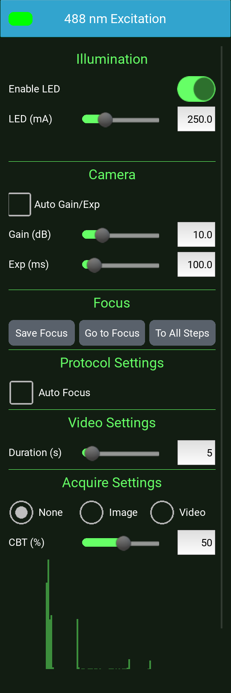

# Channels {#sec-channels}

A channel is one way of lighting and imaging the sample: a transmitted
light, a fluorescence excitation, or, on a Lumi, the sample's own light.
The right panel has one drawer for each channel your microscope has
(@sec-right-panel). This chapter describes the channels and each setting
in a channel's drawer.

## The channels {#sec-channel-kinds}

@tbl-models lists the channels of each model.

- **Transmitted light**: [Brightfield]{.channel}, [Phase Contrast]{.channel}
  and [Darkfield]{.channel}, lit from above through the AuraPhase
  (@sec-auraphase). On the LS460, LS560, LS620 and LS720 the one transmitted
  channel is [BF-Phase]{.channel}.
- **Fluorescence**: each drawer is named for its excitation wavelength, for
  example [488 nm Excitation]{.channel}, and lit by that LED.
- **Bioluminescence**: the [Lumi]{.channel} channel of the Lumi. It has no
  LED: the camera images the light the sample emits.

The drawers are listed in the same order on every model, and a channel your
microscope does not have has no drawer.

## Showing a channel {#sec-showing-a-channel}

Click a channel's title to open its drawer and show that channel: the live
image and the camera take that channel's settings. One drawer is open at a
time. Images captured with the toolbar's Capture button are named for the
channel shown.

One LED is lit at a time. If the shown channel's LED is lit when you open
another drawer, that channel's LED is lit in its place; if it is dark, the
new channel is shown dark.

While a protocol runs, the drawers cannot be changed; the run shows each
step's channel in turn.

{#fig-channels-ex488 width=35%}

## Illumination {#sec-channel-illumination}

Requires: a channel with an LED. The [Lumi]{.channel} channel has no
Illumination section, and the section is not shown when LumaViewPro runs
without the microscope's LED board.

[Enable LED]{.guilabel} lights or darkens the shown channel's LED.

[LED (mA)]{.guilabel} sets the LED's current, in milliamperes. Drag the
slider, or type a value in the box and press Enter. The slider runs to
50 mA on the transmitted channels and to the LED board's maximum on the
fluorescence channels. A typed value may be higher than the slider's
range, up to the LED board's maximum; a higher value is refused, and the
setting keeps its previous value.

The tooltip of [Auto Gain/Exp]{.guilabel} suggests an LED current of 10 to
30 mA for the transmitted channels and 50 to 400 mA for the fluorescence
channels.

Defaults: [Brightfield]{.channel} 5 mA; [Phase Contrast]{.channel} and
[Darkfield]{.channel} 50 mA; each fluorescence channel 250 mA.

## Camera {#sec-channel-camera}

Each channel keeps its own camera gain and exposure, and the camera takes
them when the channel is shown. Without a camera connected, these controls
are disabled.

[Gain (dB)]{.guilabel} amplifies the camera's signal, in decibels: 0 to
the camera's maximum, in steps of 0.1. Higher gain brightens the image and
adds noise.

[Exp (ms)]{.guilabel} is the exposure time, in milliseconds. The slider
runs to 50 ms on [Brightfield]{.channel}, to 200 ms on
[Phase Contrast]{.channel} and [Darkfield]{.channel}, and to 1000 ms, or
the camera's maximum if lower, on the fluorescence channels; on the
[Lumi]{.channel} channel it runs to the camera's maximum. On the
fluorescence and [Lumi]{.channel} channels the exposure is set in whole
milliseconds, from 1 ms. A longer exposure may be typed in the box; a gain
or exposure beyond the camera's limit is applied at that limit.

Defaults: [Brightfield]{.channel} 1 dB and 2 ms; [Phase Contrast]{.channel}
1 dB and 5 ms; [Darkfield]{.channel} 1 dB and 30 ms; each fluorescence
channel and the [Lumi]{.channel} channel 10 dB and 100 ms.

### Auto Gain/Exp {#sec-auto-gain}

Requires: a camera with automatic gain and exposure. The control is not
shown on the LS460, LS560, LS620 and LS720, nor on the [Lumi]{.channel} channel.

[Auto Gain/Exp]{.guilabel} lets the camera set the gain and the exposure
itself, continuously, to bring the image to a target brightness of 30% of
full scale. The camera measures the brightness over the central half of
the frame (half the width and half the height). While it is on, the
[Gain (dB)]{.guilabel} and [Exp (ms)]{.guilabel} controls are disabled.
The camera keeps the gain between 0 and 20 dB and the exposure at or below
50 ms on a transmitted channel, 200 ms on a fluorescence channel.

The setting belongs to the channel, and each protocol step added in that
channel takes it. A step's own setting can differ from the channel's: in a
tiled scan, for example, the steps whose tiles overlap a well's edge can
be left without Auto Gain/Exp while the steps inside the well use it.

::: {.callout-warning}
## Very dark and very light areas in one image

Auto Gain/Exp sets one brightness for the whole measured area. When that
area holds both very dark and very light parts, such as the black wall at
the edge of a well and the bright well beside it, the light part is
overexposed. Set the gain and exposure by hand for such images.
:::

### Sum {#sec-sum}

Requires: the [Lumi]{.channel} channel.

[Sum]{.guilabel} adds several frames into one image, each frame taken at
the exposure set, to collect more of a faint signal: 1 to 100 on the
slider; any whole number may be typed. Default: 1, one frame.

In the [8-bit]{.guilabel} image mode, a summed image is saved in 8 bits and
the added range is lost; a note in the drawer states this. Select a
full-depth [Image Mode]{.guilabel} to keep it (@sec-image-mode).

{#fig-channels-lumi width=35%}

## Focus {#sec-channel-focus}

Requires: a focus motor.

Each channel keeps its own saved focus, a Z position. A protocol step added
in a channel takes that channel's saved focus as its Z.

- [Save Focus]{.guilabel} saves the current Z as the channel's focus. If a
  protocol step of this channel is selected in the [Protocol]{.guilabel}
  drawer, the step takes the Z too; no other step is changed.
- [Go to Focus]{.guilabel} moves the focus to the channel's saved focus.
- [To All Steps]{.guilabel} saves the current Z as the channel's focus and
  sets every step of this channel in the current protocol to it. The
  slices of a Z-stack step keep their spacing around the new Z.

## Protocol Settings {#sec-channel-protocol-settings}

Requires: a focus motor.

[Auto Focus]{.guilabel} runs an autofocus, based on image contrast, before
each step of this channel in a protocol, and before this channel is taken
in a composite captured with the toolbar's Composite button. Default: off.

## Video Settings {#sec-channel-video}

[Duration (s)]{.guilabel} is the length of the video a protocol records in
this channel at each step, when the channel's acquire setting is
[Video]{.guilabel}: 1 to 60 seconds on the slider; a value up to 3600
seconds may be typed. Default: 5 seconds. A recording made with the
toolbar's Record button is limited by [Video Time Limit (s)]{.guilabel}
instead (@sec-advanced-camera).

## Acquire Settings {#sec-channel-acquire}

What a protocol, and the toolbar's Composite button, take in this channel:

- [None]{.guilabel}: nothing. Default.
- [Image]{.guilabel}: an image.
- [Video]{.guilabel}: a video, as long as [Duration (s)]{.guilabel}.

A composite captured with the Composite button combines the channels set
to [Image]{.guilabel}; a channel set to [Video]{.guilabel} is left out of
it. A composite takes at most one transmitted channel: the first set to
[Image]{.guilabel}, in the order [Brightfield]{.channel},
[Phase Contrast]{.channel}, [Darkfield]{.channel}.

### CBT (%) {#sec-cbt}

Requires: a fluorescence channel or the [Lumi]{.channel} channel.

[CBT (%)]{.guilabel}, the composite brightness threshold, sets which pixels
of this channel are laid over the transmitted image in a composite: a
pixel is used when its brightness is at least this percentage of full
scale. A higher percentage keeps only the brightest parts. 0 to 100;
default 50. The threshold applies only to a composite that includes a
transmitted channel; in a composite of fluorescence channels alone, every
pixel is used.

The thresholds also apply to composites generated afterwards in
[Post Processing]{.guilabel}, which uses each channel's threshold at the
time it runs. Generating a composite again with a different threshold
makes a new composite beside the earlier one.

## The histogram {#sec-histogram}

Below the acquire settings, a histogram shows how many pixels of the live
image have each brightness, dark on the left and bright on the right. It
is drawn while the channel is shown and is not updated while a protocol
runs.

## Display Properties {#sec-display-properties}

- [False Color]{.guilabel}: shows the channel in its color, the color of
  its swatch, instead of grey. Offered on the fluorescence channels and
  the [Lumi]{.channel} channel; default: on. Images saved in the
  [RGB (full depth)]{.guilabel} image mode are saved in this color
  (@sec-image-mode).
- [Log]{.guilabel}: draws the histogram's counts on a logarithmic scale,
  so that small counts remain visible beside large ones. Only the
  histogram is affected. Default: off.
