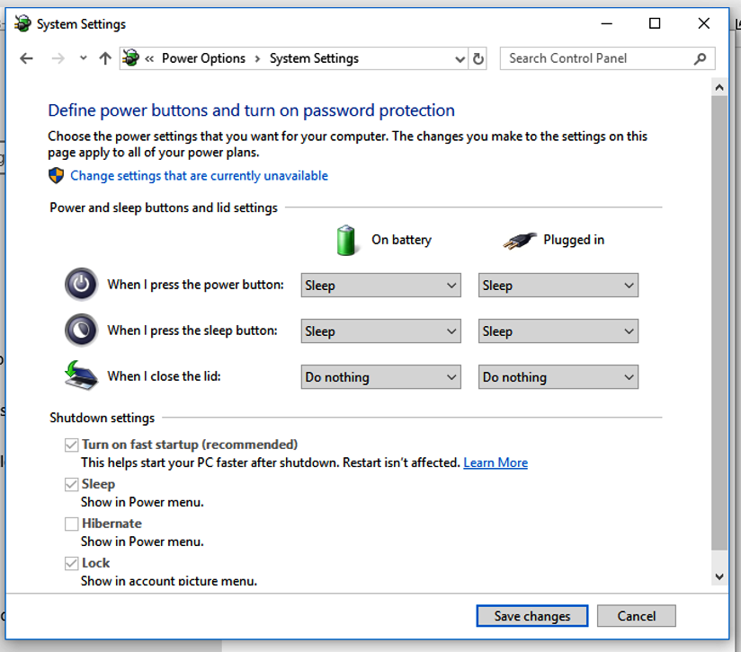

# Working farther from the microscope {#sec-extending}

The supplied USB cable is 3 meters long, and it can't be extended or
replaced (@sec-connecting). To work farther from the microscope, for
example when it is in an incubator, keep the computer beside it and extend
the monitor, keyboard and mouse instead: a longer HDMI cable to the
monitor, and a Bluetooth keyboard and mouse. That's all a desktop computer
needs. A laptop also has to work with its lid closed:

1. Connect the microscope to the laptop with the supplied USB cable.
2. Connect the laptop to an external monitor with an HDMI cable of the
   length you need.
3. Pair a Bluetooth keyboard and mouse with the laptop.
4. Open Settings, System, Display, and choose to duplicate the display on
   the external monitor.
5. Open Control Panel, Power Options, and choose what closing the lid does.
   Set "When I close the lid" to "Do nothing" and save the change
   (@fig-windows-lid).
6. Close the laptop and put it somewhere safe.

{#fig-windows-lid width=70%}
