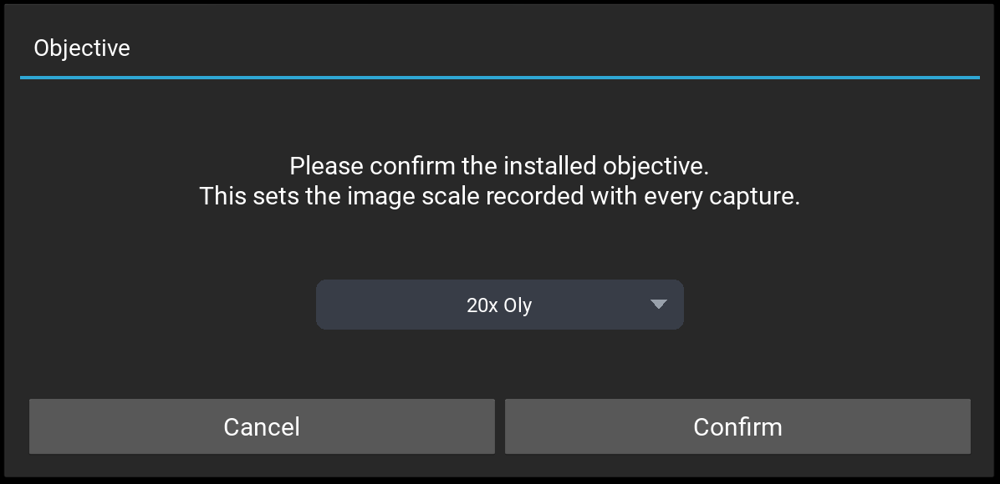
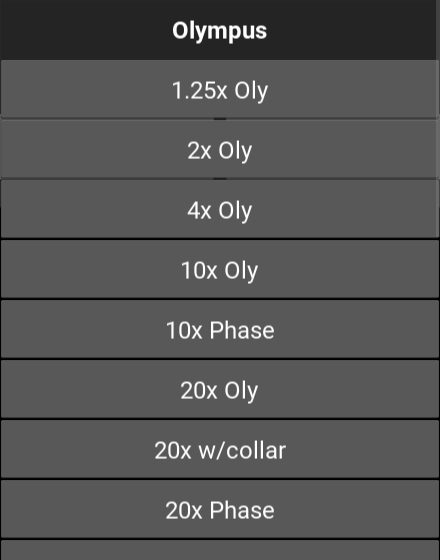
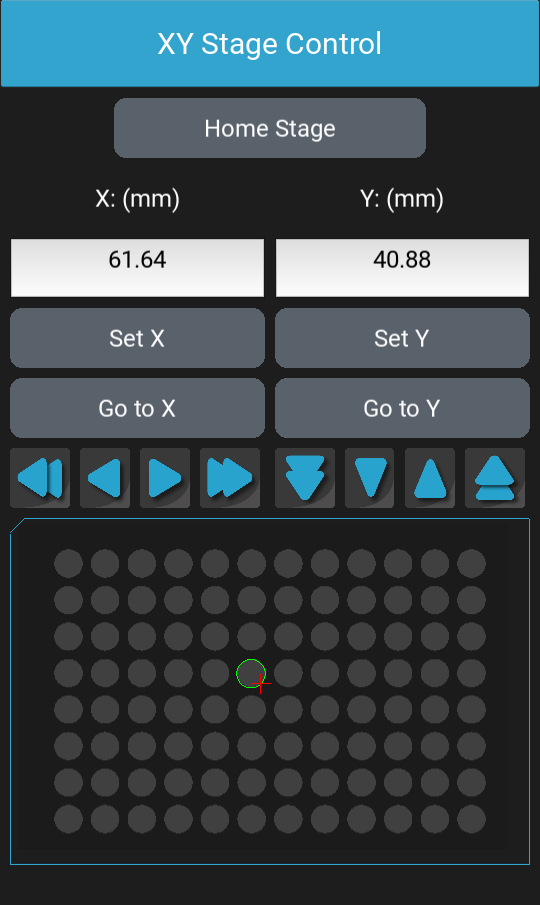

# Focus, the objective and the stage {#sec-focus}

The [Objective Control]{.guilabel} drawer in the left panel holds the focus,
autofocus, the objective in use, the turret and Z-stacks
(@fig-objective-control). On a Lumascope with a motorized XY stage, the
[XY Stage Control]{.guilabel} drawer moves the stage (@sec-xy-stage). Which
of these your microscope has is shown in @tbl-models.

The controls in these drawers are disabled while a protocol or another
acquisition runs, while the microscope homes, and while a video records.

::: {#fig-objective-control layout-ncol=2}
![On an LS850: the objective is named on [Assign Objective]{.guilabel}](images/focus-objective-control-ls850.png){#fig-objective-control-ls850 width=62%}

![On an LS850T: [Turret Selection]{.guilabel}, position 1 in the light path](images/focus-objective-control-ls850t.png){#fig-objective-control-ls850t width=62%}

The Objective Control drawer
:::

## The objective {#sec-objective}

LumaViewPro needs to know which objective is in the light path. The
objective sets the image scale recorded with every capture and shown by
the scale bar, the size of each focus and stage step, and the range an
autofocus searches.

LumaViewPro asks which objective is installed when it first starts with a
microscope, and, on a Lumascope with a turret, whenever the turret position in
the light path has no objective assigned (@fig-objective-question). It asks
again after the model is changed between one with a turret and one
without. Select the objective in the list, where the objectives are grouped
under their maker's name, and click [Confirm]{.guilabel}.

::: {#fig-objective-question layout-ncol=2}
{#fig-objective-question-popup}

{#fig-objective-question-list width=70%}

The objective question
:::

[Cancel]{.guilabel} leaves the objective unknown. Until it is known,
captures are refused, and so are the focus and stage arrows, autofocus and
Z-stacks.

On a Lumascope without a turret, the button below [Autofocus]{.guilabel} shows
the objective's name, or [Assign Objective]{.guilabel} while none is
known. Click it to change the objective. On a Lumascope with a turret, each
turret position has its own objective (@sec-turret). The objective cannot
be changed while a protocol runs or a video records.

## Adjusting the focus {#sec-focus-adjust}

Requires: a focus motor.

[Adjust Focus]{.guilabel} moves the objective up, toward the sample, and
down, away from it:

- The arrow buttons: the double arrows move a coarse step, the single
  arrows a fine step. The step is the objective's; for a 20x objective, a
  coarse step is 29 µm and a fine step 2.9 µm.
- The slider: drag the objective icon, and the focus moves when you release
  it; or click the slider's track, and the focus moves to that height.
- [Z-Position (um)]{.guilabel}: shows the focus position, in micrometers,
  or `--` while it is not known. Type a position and press Enter to move
  there.
- Over the live image, hold Ctrl and scroll the mouse wheel to move a fine
  step at a time, or hold Ctrl and Shift for coarse steps. Scrolling quickly
  takes steps up to twice as large.

A move beyond the focus motor's travel is refused, and the focus is not
moved.

[Home]{.guilabel} lowers the focus completely, to position 0.

[Set Z]{.guilabel} stores the current focus position, and
[Go to Set Z]{.guilabel} returns to it. There is one stored position,
shared by every channel. [Set All Z]{.guilabel} stores the current position
in the same way, and also saves it as the focus of every channel
(@sec-channel-focus).

## Autofocus {#sec-autofocus}

Requires: a focus motor.

[Autofocus]{.guilabel} finds the focus of the channel shown, at the current
stage position, by image contrast. It searches a range centered on the
current focus: first the whole range in coarse steps, then a narrower
range around the sharpest position in steps a third as large, and so on
down to the objective's finest step. For a 20x objective, the range is
40 µm above and below the current focus, searched in steps from 18 µm down
to 2 µm. Bring the image near focus before you start, so that the true
focus is within the range.

While it runs, the button reads [Focusing...]{.guilabel}; click it again
to stop the autofocus, which leaves the focus where it stopped. When the
autofocus ends, the focus stays at the sharpest position, which is saved
as the shown channel's focus (@sec-channel-focus). If no focus is found,
the focus returns to where it was.

An autofocus whose range would reach beyond the focus motor's travel is
refused before anything moves. Move the focus away from the end of its
travel and try again.

To autofocus before each step of a protocol, see @sec-channel-protocol-settings.

## The turret {#sec-turret}

Requires: a turret.

[Turret Selection]{.guilabel} has one button for each of the four turret
positions (@fig-objective-control-ls850t). Each button is named for the
objective assigned to its position, or shows the position's number, as in
`< 2 >`, when none is assigned. The highlighted button is the position in
the light path.

Click a position's button to turn the turret to it. The focus is lowered
completely, the turret turns, and the focus is returned to the position it
had. A different objective may need refocusing. If the new position has no
objective assigned, LumaViewPro asks which objective is installed there
(@sec-objective). The turret cannot be turned while a video records.

[Reset Turret Objective]{.guilabel} removes the objective assigned to the
position in the light path. To name that position's objective again, click
its button.

When LumaViewPro starts, and when [Home Stage]{.guilabel} is clicked, the
turret turns to position 1. Installing objectives on the turret is
described in @sec-turret-objectives.

## Z-stacks {#sec-zstack}

Requires: a focus motor.

A Z-stack is a series of images of the shown channel at evenly spaced focus
positions. Set it up under [Acquire Z Stack]{.guilabel}:

- [Step size (um)]{.guilabel}: the distance between slices, in micrometers.
- [Range (um)]{.guilabel}: the depth of the stack, in micrometers.
- [# of Steps]{.guilabel}: the number of slices, worked out from the two:
  the range divided by the step size, rounded down, plus one, so that
  there is a slice at each end. A step size of 2 µm and a range of 10 µm
  give 6 slices. When the range is not a whole number of steps, the
  slices cover slightly less than the range. The step size and the range
  must both be greater than 0.
- Where the stack sits against the current focus:
  [Current Position at Top]{.guilabel},
  [Current Position at Center]{.guilabel} or
  [Current Position at Bottom]{.guilabel}. At the top or the bottom, the
  top or bottom slice is at the current focus. At the center, the slices
  are centered on it; with an even number of slices, none is exactly at
  the current focus.

[Acquire]{.guilabel} takes the stack in the shown channel, with that
channel's settings, from the lowest slice up. Autofocus is not used. While
it runs the button shows the slice being taken, as `Z 3/6`; click it again
to stop the stack. When the stack ends, the focus returns to the position
it was at.

The slices are saved in the [Sequenced Image Format]{.guilabel}
(@sec-sequenced-format), in a new folder for each stack:
`Manual/Z-Stacks/<date>_<time>/` in the destination folder, one file per
slice, named for the channel and the slice number, for example
`ZStack_BF_Z0_0000.tiff`.

The same settings make the Z-stacks of protocol steps.

## The XY stage {#sec-xy-stage}

Requires: a motorized XY stage.

The [XY Stage Control]{.guilabel} drawer moves the stage
(@fig-xy-stage). Positions are on the labware selected in the
[Protocol]{.guilabel} drawer, in millimeters.

- [X: (mm)]{.guilabel} and [Y: (mm)]{.guilabel} show the stage's position,
  or `--` while it is not known. Type a position and press Enter to move
  there.
- The arrow buttons below them: the double arrows move a coarse step, the
  single arrows a fine step. The step is the objective's; for a 20x
  objective, a coarse step is 200 µm and a fine step 20 µm.
- [Set X]{.guilabel} and [Set Y]{.guilabel} store the current position
  on that axis; [Go to X]{.guilabel} and [Go to Y]{.guilabel} return to it.

A move beyond the stage's travel is refused, and the stage is not moved.
How quickly the stage accelerates is set by
[Acceleration Max (%)]{.guilabel} in Advanced Settings
(@sec-advanced-general).

[Home Stage]{.guilabel} homes every axis of the microscope: the focus is
lowered completely, the turret, if there is one, turns to position 1, and
the stage is driven to its home position. The stage then moves to the
middle of its travel, and the focus rises to a little above its lowest
point. Bring the sample back into focus afterwards.

{#fig-xy-stage width=30%}

### The plate map {#sec-plate-map}

Below the controls, the plate map draws the selected labware and its
wells. Once the stage is homed, a red cross marks the stage's position and
a green ring the well it is in.

- Click a point on the map to move the stage there.
- Right-click to go to the protocol step nearest that point.
- [Show step locations]{.guilabel} in Advanced Settings marks each protocol
  step on the map (@sec-advanced-protocol).

### Centering on a point of the live image {#sec-click-to-center}

Right-click a point of the live image to move the stage so that the point
is at the center of the image. The objective must be known.
