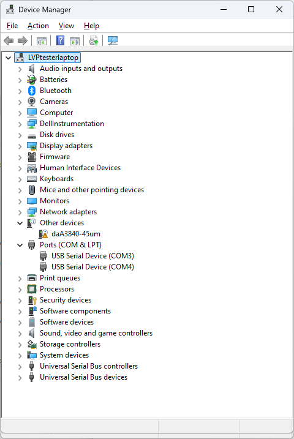
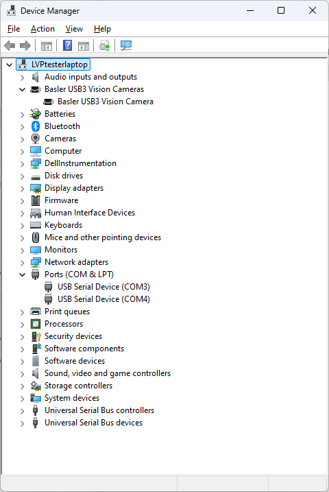

# Installing LumaViewPro and connecting {#sec-installing}

Install LumaViewPro before you connect the microscope to the computer for
the first time: the installer puts the camera's driver on the computer, so
the camera is recognized the moment it is plugged in.

## Your computer {#sec-computer}

LumaViewPro is installed on Windows 10 or 11. A desktop or a laptop will do.
The monitor does not change the images LumaViewPro saves; a poor monitor
only makes focus harder to judge by eye.

LumaViewPro can also be run from its source code on Windows, macOS or Linux,
with Python 3.12 or 3.13. The `README.md` on the
[LumaViewPro GitHub page](https://github.com/EtalumaSupport/LumaViewPro)
says how.

## Downloading and installing {#sec-download}

Download LumaViewPro from either place:

- the [Etaluma downloads page](https://etaluma.com/products/downloads/);
- the [LumaViewPro releases on GitHub](https://github.com/EtalumaSupport/LumaViewPro/releases).

The download is a zip file holding the setup program,
`LumaViewPro-<version>-setup.exe`. One setup program serves every Lumascope
model.

1. Open the zip file and run the setup program.
2. Follow its steps. It installs LumaViewPro and the drivers the Lumascope
   cameras need.

The installer puts LumaViewPro in `Program Files\LumaViewPro` and makes two
shortcuts named LumaViewPro, with the orange Etaluma icon: one on the
desktop and one in the Start menu. Start LumaViewPro from either, or pin it
to the taskbar.

LumaViewPro keeps your settings, protocols and logs in a folder of your
Documents named for the version, for example `Documents\LumaViewPro 4.0.0`.

## Connecting the microscope {#sec-connecting}

1. Plug the microscope end of the supplied USB cable into the port labeled
   **COMPUTER** on the microscope (@sec-cables), if it is not already.
2. Plug the other end into a USB3 port on the computer, directly: not into a
   USB hub.
3. Plug the power supply's barrel connector into the port labeled
   **POWER INPUT 24V DC**, and the power supply into an AC outlet.

Place the computer on a flat, stable surface within reach of the 3 metre
USB cable.

::: {.callout-warning title="Use only the supplied USB cable"}
Do not extend the USB cable or replace it with another: the connection to
the microscope will fail. To work farther from the microscope, extend the
monitor, keyboard and mouse instead (@sec-extending).
:::

### Through an incubator port {#sec-incubator-port}

For live-cell imaging in an incubator (@sec-incubator), pass the USB cable
and the 24 V DC cable through the incubator's port, which is often on the
upper back wall.

- Keep the power supply outside the incubator: only its 24 V DC cable goes
  in. Do not leave the power supply hanging by its DC
  cable; support it, or fix it to the back of the incubator.
- Seal around the cables with the foam plug supplied, or adapt the port's
  own plug or stopper.
- Leave enough slack in the cables inside the incubator for the shelf to
  slide out.

## Troubleshooting {#sec-troubleshooting}

### The microscope is not found {#sec-not-found}

When LumaViewPro starts, it looks for the microscope's camera, its LED board
and, on a scope with motors, its motor controller. If nothing is found it
says so once, "No hardware detected", and offers to go on in software-only
mode: you can design protocols and see the controls, but nothing is
captured. If one part is missing it names that part, for example "Camera not
found. Check USB cable and power." While no camera is connected, the image
area shows a picture of a camera and a USB cable.

Check, then restart LumaViewPro:

1. The microscope has power: the power supply is plugged into a live outlet
   and its barrel connector into **POWER INPUT 24V DC**.
2. The USB cable is plugged in at both ends.
3. The USB cable is in a USB3 port (below).

### A USB2 port {#sec-usb2}

On a USB2 port the camera does not work: Windows finds it but loads no
driver for it. In Device Manager it is then listed under "Other devices"
(@fig-usb2), where on a USB3 port it is listed under "Basler USB3 Vision
Cameras" (@fig-usb3). Move the cable to a USB3 port, often marked SS or colored
blue, and restart LumaViewPro.

::: {layout-ncol=2}
{#fig-usb2}

{#fig-usb3}
:::

### A panel taller than the window {#sec-display-scale}

A side panel taller than the LumaViewPro window scrolls, and the
Protocol panel's run buttons stay in view below it. If the text is larger
than you want, lower Windows' display scale: Settings, System, Display,
Scale.

### Sending a support report {#sec-support-report}

When asking Etaluma for help, attach a support report. In the
[Microscope Settings]{.guilabel} panel, [Generate Support Report]{.guilabel}
tests the microscope and saves a zip of the results and LumaViewPro's logs
to your desktop. On a scope with motors it homes and moves the stage, so
take any sample off the stage first. It can take a few minutes.
[Zip Logs Only]{.guilabel} saves the logs alone, quickly, and moves nothing.

Send the zip to Etaluma Technical Support at support@etaluma.com.
