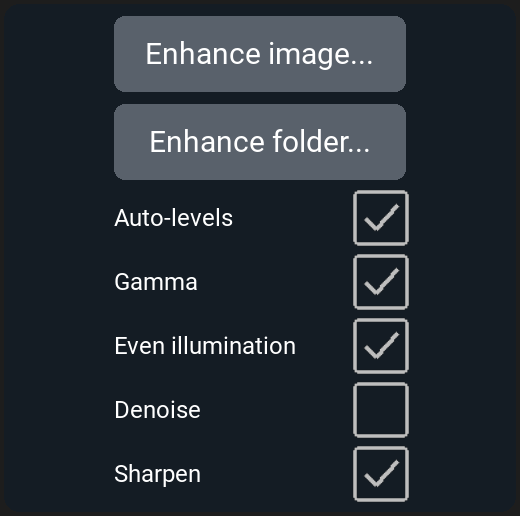

# Post-processing {#sec-post-processing}

The [Post Processing]{.guilabel} drawer of the left panel (@fig-pp-drawer)
holds six tools that work on images already saved:

- [Create Video]{.guilabel} makes videos from a time-lapse or a recording
  (@sec-pp-video).
- [Stitch]{.guilabel} joins the tiles of a tiled scan into one image
  (@sec-pp-stitch).
- [Composite Generation]{.guilabel} combines the channels of each position
  into one color image (@sec-pp-composite).
- [Z-Projection]{.guilabel} makes one image from each Z-stack
  (@sec-pp-zprojection).
- [Quick Enhance]{.guilabel} makes an adjusted copy of an image for viewing
  (@sec-pp-enhance).
- [Object Analysis]{.guilabel} counts and measures objects, and plots the
  results (@sec-pp-objects).

{#fig-pp-drawer width=35%}

None of the tools changes or deletes the images it reads; each saves what
it makes as new files beside the source.

## Which folder to choose {#sec-pp-folders}

[Create Video]{.guilabel}, [Stitch]{.guilabel},
[Composite Generation]{.guilabel} and [Z-Projection]{.guilabel} each work on
a whole folder that LumaViewPro saved:

- a protocol run's folder, `ProtocolData/<date>_<time>` (@sec-protocol-files);
- a Z-stack's or a composite's folder, `Manual/Z-Stacks/<date>_<time>` or
  `Manual/Composites/<date>_<time>` (@sec-image-files);
- for [Create Video]{.guilabel} only, a recording saved as frames
  (@sec-video-format).

Run, Z-stack and composite folders each hold `protocol_record.tsv`, a
record of every image taken and where. A recording saved as frames has no
record; [Create Video]{.guilabel} reads its frames instead. The tools read
the record, not the file names, to find each image's channel, position,
tile, Z-slice and time. A folder without a record isn't accepted
("Protocol and/or Protocol Record not found in folder"). The images must
be TIFF or OME-TIFF. No tool will work on a run saved as JPG, because a
JPG holds only what the screen showed, none of the capture's details.

Click the tool's button and choose the folder. The folder picker starts in
`ProtocolData`. On Windows and Linux it shows folders only, not the files
in them.

While a tool is running, a window shows its progress. When it finishes,
the window lists what was made and any images it left out. You can't start
a run while a tool is running, or start a tool while a run, a recording or
homing is using the microscope, or while a finished run's files are still
being written. The tool's button is greyed out, or a message gives the
reason. Try again when that work is done.

### What each tool makes {#sec-pp-outputs}

Each tool saves into a new folder inside the folder you chose, named for
what it did:

| Folder | What it holds |
|:---|:---|
| `Video` | Videos of the images as taken. |
| `Stitched` | Stitched images. |
| `Composite` | Composites. |
| `ZProject` | Z-projections. |
| `Composite-Stitched`, `Stitched-ZProject`, ... | Images made from images another tool made: for example, `Stitched-ZProject` holds stitched Z-projections. |

: The folders the post-processing tools write {#tbl-pp-folders tbl-colwidths="[40,60]"}

Each tool works on the images as taken and on whatever the other tools
have already made in the folder, except [Z-Projection]{.guilabel}, which
projects only the slices as taken. The order you run them in decides what
you get. For a tiled run with Z-stacks in several channels, run:

1. [Z-Projection]{.guilabel}, to project each tile's stack;
2. [Stitch]{.guilabel}, which stitches the slices and the projections;
3. [Composite Generation]{.guilabel}, which composites the tiles, the
   stitched images and the projections;
4. [Create Video]{.guilabel}, for a time-lapse, which makes a video of each.

Running a tool again on the same folder skips what it already made.
`protocol_post_record.tsv` in the folder records how each new image was
made.

To keep a later tool from using a derived folder, delete that whole folder
first, for example `Composite`. Don't delete images the run took: a tool
reports any image the record lists but the folder no longer has
("frame(s) the run recorded are missing"), and builds nothing from them.

## Making a video from images {#sec-pp-video}

[Create Video...]{.guilabel} makes a video from a folder:

- a protocol run with more than one scan: one video for each position,
  channel, tile and Z-slice, with one frame from each scan, in order. A
  run of a single scan isn't accepted ("Video requires multiple time
  points per scan position");
- a recording saved as frames: one video of the recording.

Its settings:

- [Frames/Second]{.guilabel}: the speed the video plays at. Left blank
  ("auto"), a recording plays at the rate it was recorded and a protocol
  run at 5 frames a second. A typed value must be a whole number, 1 or
  more.
- [Overlay Timestamp]{.guilabel}: when on, each frame shows the date and
  time it was taken, to the millisecond, in its lower left corner. Default: on.

Videos are MP4 files (H.264), 8 bits per channel. A protocol run's videos are
saved in its `Video` folder, or, for images another tool made, in a folder
named for both, for example `Composite-Video`. A recording's video is saved
inside the recording's own folder, named for the folder:
`Video_2026-11-04_22.53.29/Video_2026-11-04_22.53.29.mp4`.

## Stitching tiles into one image {#sec-pp-stitch}

*Motorized XY stage only.* On a Lumascope without one, the
[Stitch]{.guilabel} item isn't shown.

Stitch joins the tiles of each tiled step (@sec-protocol-tiling) into one
image: one image for each well, channel, Z-slice and scan. It places each
tile where the stage was when the tile was taken, using the run's record,
and keeps the tiles' own pixels and colors.

- [Quality Stitch]{.guilabel}: where tiles overlap, it fine-tunes each
  tile's position by matching the overlap, with a small local search.
- [Fast Preview Stitch]{.guilabel}: a faster match, for a quick look.

Tiles taken with no overlap ([Tiling Overlap]{.guilabel} 0 in Advanced
Settings, @sec-advanced-protocol) are placed by stage position alone in
both modes. Neither mode corrects lens distortion toward the edges of each
tile.

Stitched images are saved in the run's `Stitched` folder, their names
ending in `_stitched`, or `_stitched_FastPreview` for a fast preview.
Composites aren't stitched: for a stitched composite, stitch first,
then run [Composite Generation]{.guilabel}, which composites the stitched
channels.

## Combining channels into one image {#sec-pp-composite}

[Create Composites...]{.guilabel} combines the channels taken at the same
position in the same scan into one color image: each fluorescence or
[Lumi]{.channel} channel in its color, laid over a transmitted-light
channel (Brightfield, Phase Contrast or Darkfield) in gray if one was
taken. Each color channel shows over the gray where it's brighter than its
[CBT (%)]{.guilabel}, as set in its channel drawer when the tool runs
(@sec-cbt). A composite can include only one transmitted-light image: a
position with two, Brightfield and Phase Contrast for example, is skipped,
and the window lists its images.

Composites are 8-bit color images, saved in the run's `Composite` folder:
OME-TIFF when every image combined is OME-TIFF, otherwise TIFF. Each name
includes a six-character code for the settings used, for example
`custom0000_Composite_TA1_0000_a01a3c.tiff`, so a composite made again
with different settings is saved beside the first instead of replacing
it.

To make one composite manually, at the microscope, use the toolbar's
Composite button instead (@sec-image-composite).

## Flattening a Z-stack into one image {#sec-pp-zprojection}

[Z-Project Folder...]{.guilabel} makes one image from each Z-stack in the
folder: one for each position, channel, tile and scan. Choose the
projection in [Method]{.guilabel} first. Default: Max.

It projects only the slices as taken. Stitched or composite images of the
slices are left out and listed: project the slices first, then stitch or
composite the projections. A folder with only such images isn't
accepted.

| Method | Each pixel of the projection is |
|:---|:---|
| Min | the dimmest value of that pixel across the slices. |
| Max | the brightest value across the slices. |
| Average | the mean of the values, rounded to a whole number. |
| Median | the middle value, rounded to a whole number. |
| Sum | the sum of the values. An 8-bit stack is summed into a 16-bit image; a 16-bit sum stops at 65535, the brightest a 16-bit image can hold. |
| StdDev | the standard deviation of the values: how much the pixel changes through the stack. |

: The projection methods {#tbl-pp-zprojection tbl-colwidths="[20,80]"}

Max shows the brightest structures from every depth in focus at once; Min
shows the darkest. Average and Median lower the noise. Sum keeps the total
light, useful for a faint sample. StdDev shows what changes with depth.

The folder picker starts in `Manual/Z-Stacks` or `ProtocolData`, whichever
exists, or the destination folder when both or neither do. Projections are
saved in the folder's `ZProject` folder, their names ending in `_zproj_`
and the method: `custom0000_BF_TA1_0000_zproj_max.tiff`.

## Making an image easier to see {#sec-pp-enhance}

Quick Enhance makes an adjusted copy of an image that's easier to look at.
It has five steps, each with its own switch below the two buttons
(@fig-pp-enhance):

- [Auto-levels]{.guilabel} stretches the brightness so that the dimmest 1%
  of the pixels are black and the brightest 1% are white.
- [Gamma]{.guilabel} brightens the midtones a little.
- [Even illumination]{.guilabel} evens out light that's brighter in one
  part of the field than another.
- [Denoise]{.guilabel} smooths pixel noise with a 3-pixel median.
- [Sharpen]{.guilabel} sharpens fine detail where the image has signal,
  leaving the background as it is.

Every step except [Denoise]{.guilabel} is on until you turn it off.
LumaViewPro remembers the switches from one session to the next. The numbers each step uses are fixed.

{#fig-pp-enhance width=35%}

The copy isn't for measurement: its brightness no longer represents the
light from the sample. Measure on the images as taken.

- [Enhance image...]{.guilabel}: choose one image: TIFF, OME-TIFF, PNG, JPG
  or BMP.
- [Enhance folder...]{.guilabel}: choose a folder; every image directly in
  it is enhanced, except copies that are already enhanced. Subfolders
  aren't included.

Each copy is saved beside its source, named after it, as TIFF (OME-TIFF for an
OME-TIFF source): `ZStack_Ex405_Z0_0000_enhanced.tiff`. Beside it, a
`.recipe.json` file of the same name records each step and its settings.
Enhancing an image again saves a new copy, `_enhanced_001`, and so on. Each
copy is shown for a moment in the image view as it's saved.

## Counting and measuring objects {#sec-pp-objects}

[Object Analysis]{.guilabel} counts the objects in each image of a folder,
cells for example, and measures their area and brightness.
[Analyze]{.guilabel} opens the analysis (@fig-pp-object-analysis);
[Plot]{.guilabel} plots its results (@sec-pp-plot).

{#fig-pp-object-analysis width=45%}

The settings that decide what counts as an object make up the method. Set the
method on one example image, then apply it to a folder:

1. Click [Load Image]{.guilabel} and choose an image like those you will
   count. It appears beside the controls.
2. Set the controls below, then click [Apply Method to Preview]{.guilabel}.
   Objects that meet the method are outlined. Changing a control doesn't
   update the outlines until you click the button again.
3. Click [Save Method As...]{.guilabel} to keep the method as a `.json`
   file, or [Load Method]{.guilabel} to use one saved before.
4. Above [Apply Method to Folder]{.guilabel}, choose the channel to count:
   All channels, or one channel, so a method set on a BF image counts only
   BF images and one set on a fluorescence image counts only that
   channel's. Images of other channels are left out and listed.
5. Click [Apply Method to Folder]{.guilabel} and choose the folder to
   count.

The controls:

- [Pixel Ratio]{.guilabel}: the number of camera pixels per micrometer of
  sample. Leave it blank ("image") to measure each image at the scale saved
  in its own file; every image LumaViewPro takes on a Lumascope with known
  optics records one. Type a value only for images with no saved scale, or
  to override it. An image with no scale and no Pixel Ratio is measured in
  pixels, and [Area]{.guilabel} or [Perimeter]{.guilabel} limits can't be
  used on it.
- [Fluorescent Image]{.guilabel}: when on, objects are brighter than the
  background, as in fluorescence. When off, they're darker, as in a
  transmitted-light image, and the image is inverted before counting.
  Default: on.
- [Threshold]{.guilabel}: the brightness, in percent of full scale, above
  which a pixel belongs to an object. Default: 20%; between 5% and 30%
  suits most samples.
- [Area]{.guilabel}, in µm², and [Perimeter]{.guilabel}, in µm: the
  smallest and largest object kept. Each slider goes up to the largest
  size the loaded image can hold; "any" means no limit.
- [Sphericity]{.guilabel}: how round an object is, from 0 to 1, where 1 is
  a circle.
- [Min Intensity]{.guilabel}, [Mean Intensity]{.guilabel} and
  [Max Intensity]{.guilabel}: the limits on an object's darkest, mean and
  brightest pixel, in percent of full scale.

The count looks only at images directly in the folder you chose, not in
subfolders. In a protocol run's folder, or a folder inside one such as
`ZProject`, it counts only the images the run's records list: the run's
captures and the images the post-processing tools made from them. Any other
image, such as a [Quick Enhance]{.guilabel} copy or a file you put there, is
left out. In a folder without a run, it counts every image except
[Quick Enhance]{.guilabel} copies. The count lists each image it left out,
and why. If the run's records can't be read, or the run's protocol file is
missing, the count tells you and counts nothing.

It writes `results.csv` in that folder, one row per image counted, in the
order the images were taken, or by name where that order isn't known:

| Column | What it holds |
|:---|:---|
| `file` | The image. |
| `well` | The well the image was taken in, as the image states it; blank if it states none. |
| `channel` | The channel the image was taken in, as the image states it, else as the run's record does. |
| `scan` | The scan of the run the image was taken in, counted from 0 as the file names count it; blank in a folder with no run. |
| `tile` | The image's tile, from the run's record; blank for a stitched image and in a folder with no run. |
| `z` | The focus position the image was taken at, in µm, as the image states it; blank for a Z-projection, which states none. |
| `time` | When the image was taken, as the image states it. An image a tool made, such as a Z-projection, states none; its time is its scan's, from the run's record. Blank if neither states one. |
| `num_cells` | The number of objects counted. |
| `total_object_area_px2` | Their total area, in pixels. |
| `total_object_area_um2` | Their total area, in µm². |
| `total_object_intensity` | Their total brightness. |

: The columns of results.csv {#tbl-pp-results tbl-colwidths="[35,65]"}

Beside it, the count writes `results_method.json`, the method it used, so
you can always tell how a count was made. [Load Method]{.guilabel} opens it
like any saved method. A count never overwrites an earlier one: counting a
folder again writes `results_001.csv` and `results_001_method.json`, then
`results_002.csv` and so on, and tells you which files it wrote. If either
file can't be written, the count tells you, and no method file is left
beside results it didn't make.

### Graphing the results {#sec-pp-plot}

[Plot]{.guilabel} graphs a `results.csv`:

1. Click Load Object-Analysis Data and choose the file.
2. Choose the X-Axis Data and the Y-Axis Data: any column of numbers, and,
   for the X axis, `time`. Each point is one image.
3. Choose a Trendline: None, Linear, Quadratic, Exponential, Power or
   Logarithmic, as the data allows; with `time` on the X axis, Linear,
   Quadratic or Exponential.
4. Type a Graph Title and the axis labels, if you want them.
5. Click Save Graph as PNG to save the graph as an image.

You can also open the file in a spreadsheet for any other analysis.
