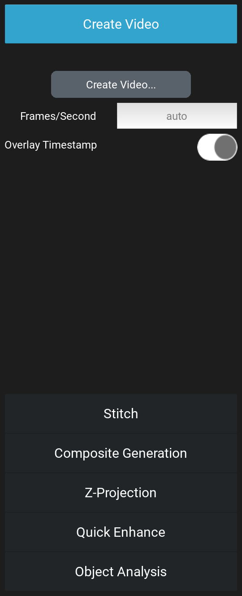
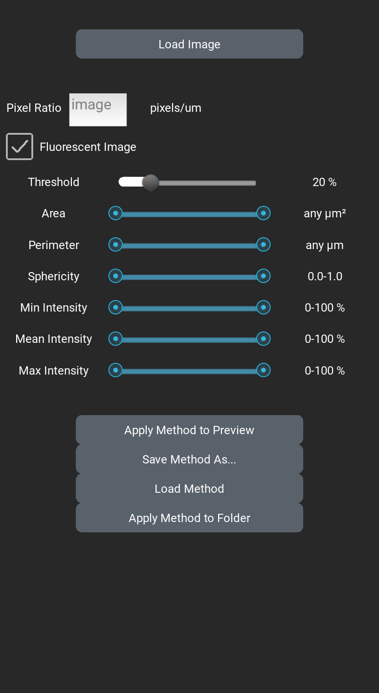

# Post-processing {#sec-post-processing}

The [Post Processing]{.guilabel} drawer of the left panel (@fig-pp-drawer)
holds six tools that work on images already saved:

- [Create Video]{.guilabel} makes videos from a time-lapse or a recording
  (@sec-pp-video).
- [Stitch]{.guilabel} joins the tiles of a tiled scan into one image
  (@sec-pp-stitch).
- [Composite Generation]{.guilabel} combines the channels of each position
  into one color image (@sec-pp-composite).
- [Z-Projection]{.guilabel} makes one image from each Z-stack
  (@sec-pp-zprojection).
- [Quick Enhance]{.guilabel} makes an adjusted copy of an image for viewing
  (@sec-pp-enhance).
- [Object Analysis]{.guilabel} counts and measures objects, and plots the
  results (@sec-pp-objects).

{#fig-pp-drawer width=35%}

None of the tools changes or deletes an image it reads. Each writes what it
makes into new files beside its source.

## The folders the tools read {#sec-pp-folders}

[Create Video]{.guilabel}, [Stitch]{.guilabel},
[Composite Generation]{.guilabel} and [Z-Projection]{.guilabel} each work on
a whole folder that LumaViewPro saved:

- a protocol run's folder, `ProtocolData/<date>_<time>` (@sec-protocol-files);
- a Z-stack's or a composite's folder, `Manual/Z-Stacks/<date>_<time>` or
  `Manual/Composites/<date>_<time>` (@sec-image-files);
- for [Create Video]{.guilabel} only, a recording saved as frames
  (@sec-video-format).

A run's, a Z-stack's and a composite's folder holds `protocol_record.tsv`,
the record of every image taken and where; a recording saved as frames
holds none, and [Create Video]{.guilabel} reads its frames instead. A tool reads the record, not the file names: it finds each
image's channel, position, tile, Z-slice and time there. A folder without a
record is refused ("Protocol and/or Protocol Record not found in folder").
The images must be TIFF or OME-TIFF; a run saved as JPG or PNG is refused
before anything is built.

Click the tool's button and choose the folder. The folder picker starts in
`ProtocolData`. On Windows and Linux it shows folders only, not the files
in them.

While a tool runs, a window shows its progress. When it ends, the window
says what was made, and names any images it left out. A run cannot be
started while a tool is running, and a tool cannot be started while a run,
a recording or a home is using the microscope, or while a finished run's
files are still being written: its button is greyed, or it is refused with
the reason. Try again when that work ends.

### What each tool writes {#sec-pp-outputs}

Each tool writes into a new folder inside the folder chosen, named for what
was done:

| Folder | What it holds |
|:---|:---|
| `Video` | Videos of the images as taken. |
| `Stitched` | Stitched images. |
| `Composite` | Composites. |
| `ZProject` | Z-projections. |
| `Composite-Stitched`, `Stitched-ZProject`, ... | Images made from images another tool made: for example, `Stitched-ZProject` holds stitched Z-projections. |

: The folders the post-processing tools write {#tbl-pp-folders tbl-colwidths="[40,60]"}

A tool works on the images as taken and on every image the other tools
have already made in the folder. The order in which you run them decides
what you get. For a tiled run with Z-stacks in several channels, run:

1. [Z-Projection]{.guilabel}, to project each tile's stack;
2. [Stitch]{.guilabel}, which stitches the slices and the projections;
3. [Composite Generation]{.guilabel}, which composites the tiles, the
   stitched images and the projections;
4. [Create Video]{.guilabel}, for a time-lapse, which makes a video of each.

A tool run again on the same folder skips what it has already made, and
`protocol_post_record.tsv` in the folder records how each new image was
made.

To leave a derived folder out of a later tool, delete that whole folder
first, for example `Composite`. Do not delete images the run took: a tool
reports the images the record lists and the folder has lost ("frame(s) the
run recorded are missing"), and builds nothing from them.

## Create Video {#sec-pp-video}

[Create Video...]{.guilabel} makes a video from a folder:

- a protocol run with more than one scan: one video for each position,
  channel, tile and Z-slice, its frames the scans in order. A run of a
  single scan has nothing to make a video of, and is refused ("Video
  requires multiple time points per scan position");
- a recording saved as frames: one video of the recording.

Its settings:

- [Frames/Second]{.guilabel}: the speed the video plays at. Blank ("auto"),
  a recording plays at the rate it was recorded, and a protocol run at 5
  frames a second. A typed value must be a whole number of at least 1; a
  lower value is refused.
- [Overlay Timestamp]{.guilabel}: on, each frame shows the date and time it
  was taken, to the millisecond, in its lower left corner. Default: on.

Videos are MP4 files (H.264), 8 bits a channel. A protocol run's videos are
saved in its `Video` folder, or, for images another tool made, in a folder
named for both, for example `Composite-Video`. A recording's video is saved
inside the recording's own folder, named for the folder:
`Video_2026-11-04_22.53.29/Video_2026-11-04_22.53.29.mp4`.

## Stitch {#sec-pp-stitch}

Requires: a motorized XY stage. On a Lumascope without one, the
[Stitch]{.guilabel} item is not shown.

Stitch joins the tiles of each tiled step (@sec-protocol-tiling) into one
image: one image for each well, channel, Z-slice and scan. It places each
tile where the stage was when the tile was taken, read from the run's
record. The tiles' own pixels and colors are
kept.

- [Quality Stitch]{.guilabel}: where the tiles overlap, it fine-tunes each
  tile's place by matching the overlap, a small local search.
- [Fast Preview Stitch]{.guilabel}: a faster match, for a quick look.

Tiles taken with no overlap ([Tiling Overlap]{.guilabel} 0 in Advanced
Settings, @sec-advanced-protocol) are placed by the stage alone in both
modes. Neither
mode corrects the distortion of the lens toward the edge of each tile.

Stitched images are saved in the run's `Stitched` folder, their names
ending in `_stitched`, or `_stitched_FastPreview` for a fast preview.
Composites are not stitched: to get a stitched composite, stitch first,
then run [Composite Generation]{.guilabel}, which composites the stitched
channels.

## Composite Generation {#sec-pp-composite}

[Create Composites...]{.guilabel} combines the channels taken at the same
place in the same scan into one color image: each fluorescence or
[Lumi]{.channel} channel in its color, laid over one transmitted channel
(Brightfield, Phase Contrast or Darkfield) in gray when one was taken. Each
color channel shows over the gray where it is brighter than its
[CBT (%)]{.guilabel}, as set in its channel drawer when the tool runs
(@sec-cbt). A composite takes one transmitted image: a place with two,
Brightfield and Phase Contrast for example, is not built, and the window
names its images.

Composites are 8-bit color images, saved in the run's `Composite` folder:
OME-TIFF when every image combined is OME-TIFF, otherwise TIFF. Each name
carries a six-character code for the settings it was made with, for
example `custom0000_Composite_TA1_0000_a01a3c.tiff`, so a composite made
again with other settings is saved beside the first instead of over it.

To make one composite by hand at the microscope, use the toolbar's
Composite button instead (@sec-image-composite).

## Z-Projection {#sec-pp-zprojection}

[Z-Project Folder...]{.guilabel} makes one image from each Z-stack in the
folder: one for each position, channel, tile and scan. Choose the
projection in [Method]{.guilabel} first. Default: Max.

| Method | Each pixel of the projection is |
|:---|:---|
| Min | the dimmest value of that pixel across the slices. |
| Max | the brightest value across the slices. |
| Average | the mean of the values, rounded to a whole number. |
| Median | the middle value, rounded to a whole number. |
| Sum | the sum of the values. An 8-bit stack is summed into a 16-bit image; a 16-bit sum stops at 65535, the brightest a 16-bit image can hold. |
| StdDev | the standard deviation of the values: how much the pixel changes through the stack. |

: The projection methods {#tbl-pp-zprojection tbl-colwidths="[20,80]"}

Max shows the brightest structures from every depth in focus at once; Min
the darkest. Average and Median lower the noise. Sum keeps the total light,
for a faint sample. StdDev shows what changes with depth.

The folder picker starts in `Manual/Z-Stacks` or `ProtocolData`, whichever
exists, or the destination folder when both or neither do. Projections are
saved in the folder's `ZProject` folder, their names ending in `_zproj_`
and the method: `custom0000_BF_TA1_0000_zproj_max.tiff`.

## Quick Enhance {#sec-pp-enhance}

Quick Enhance makes an adjusted copy of an image, easier to look at:

1. It evens out light that is brighter in one part of the field than
   another.
2. It stretches the brightness so that the dimmest 1% of the pixels are
   black and the brightest 1% are white, and brightens the midtones a
   little.
3. It sharpens fine detail where the image has signal, leaving the
   background as it is.

The steps and their settings are fixed. The copy is not for measurement:
its brightness no longer stands for the light from the sample. Measure on
the images as taken.

- [Enhance image...]{.guilabel}: choose one image: TIFF, OME-TIFF, PNG, JPG
  or BMP.
- [Enhance folder...]{.guilabel}: choose a folder; every image directly in
  it is enhanced, except copies already enhanced. Folders inside it are
  not.

Each copy is saved beside its source, named for it, in TIFF (OME-TIFF for an
OME-TIFF source): `ZStack_Ex405_Z0_0000_enhanced.tiff`. Beside it, a
`.recipe.json` file of the same name records each step and its settings.
Enhancing an image again saves a new copy, `_enhanced_2`, and so on. Each
copy is shown for a moment in the image view as it is saved.

## Object Analysis {#sec-pp-objects}

[Object Analysis]{.guilabel} counts the objects in each image of a folder,
cells for example, and measures their area and brightness.
[Analyze]{.guilabel} opens the analysis (@fig-pp-object-analysis);
[Plot]{.guilabel} plots its results (@sec-pp-plot).

{#fig-pp-object-analysis width=45%}

The settings that decide what counts as an object are the method. Set the
method on one example image, then apply it to a folder:

1. Click [Load Image]{.guilabel} and choose an image like those you will
   count. It is shown beside the controls.
2. Set the controls below, then click [Apply Method to Preview]{.guilabel}.
   The objects that meet the method are outlined. A control changed does
   not change the outlines until you click it again.
3. Click [Save Method As...]{.guilabel} to keep the method as a `.json`
   file, or [Load Method]{.guilabel} to use one saved before.
4. Choose the channel to count above [Apply Method to Folder]{.guilabel}:
   All channels, or one channel, so that a method set on a BF
   image counts only the BF images and one set on a fluorescence image
   only that channel's. The images of other channels are left out, and
   named.
5. Click [Apply Method to Folder]{.guilabel} and choose the folder to
   count.

The controls:

- [Pixel Ratio]{.guilabel}: the camera pixels in one micrometer of the
  sample. Leave it blank ("image"): each image is then measured at the
  scale saved in its own file, which every image LumaViewPro takes on a
  Lumascope with known optics records. Type a value only for images that state
  no scale, or to override it. An image with no scale and no Pixel Ratio
  is measured in pixels, and an [Area]{.guilabel} or
  [Perimeter]{.guilabel} limit on it is refused.
- [Fluorescent Image]{.guilabel}: on, objects are brighter than the
  background, as in fluorescence. Off, they are darker, as in a
  transmitted-light image, and the image is inverted before it is counted.
  Default: on.
- [Threshold]{.guilabel}: the brightness, in percent of full scale, above
  which a pixel belongs to an object. Default: 20%; between 5% and 30%
  suits most samples.
- [Area]{.guilabel}, in µm², and [Perimeter]{.guilabel}, in µm: the
  smallest and largest object kept. Each slider reaches the largest size
  the loaded image can hold; "any" is no limit.
- [Sphericity]{.guilabel}: how round an object is, from 0 to 1, 1 a circle.
- [Min Intensity]{.guilabel}, [Mean Intensity]{.guilabel} and
  [Max Intensity]{.guilabel}: the limits on an object's darkest, mean and
  brightest pixel, in percent of full scale.

The count looks at the images directly in the folder chosen; folders inside
it are not searched. In a protocol run's folder, or a folder inside one such
as `ZProject`, it counts only the images the run's records name: the run's
captures and the images the post-processing tools made from them. Any other
image, such as a [Quick Enhance]{.guilabel} copy or a file you put there, is
left out. In a folder that holds no run, it counts every image except a
[Quick Enhance]{.guilabel} copy. The count names each image it left out, and
why. If the run's records cannot be read, or the run's protocol file is
gone, the count says so and counts nothing.

It writes `results.csv` in that folder, one row for each image counted, in
the order the images were taken, and by name where that cannot be told:

| Column | What it holds |
|:---|:---|
| `file` | The image. |
| `well` | The well the image was taken in, as the image states it; blank if it states none. |
| `channel` | The channel the image was taken in, as the image states it, else as the run's record does. |
| `scan` | The scan of the run the image was taken in, counted from 0 as the file names count it; blank in a folder with no run. |
| `tile` | The image's tile, from the run's record; blank for a stitched image and in a folder with no run. |
| `z` | The focus position the image was taken at, in µm, as the image states it; blank for a Z-projection, which states none. |
| `time` | When the image was taken, as the image states it. An image a tool made, such as a Z-projection, states none; its time is its scan's, from the run's record. Blank if neither states one. |
| `num_cells` | The number of objects counted. |
| `total_object_area_px2` | Their total area, in pixels. |
| `total_object_area_um2` | Their total area, in µm². |
| `total_object_intensity` | Their total brightness. |

: The columns of results.csv {#tbl-pp-results tbl-colwidths="[35,65]"}

Beside it, the count writes `results_method.json`: the method it counted
by, so you can always tell how a count was made. [Load Method]{.guilabel}
opens it like any saved method. An earlier `results.csv` and
`results_method.json` in the folder are replaced once both new ones are
complete. If either cannot be written, the count says so, and no method
is left beside results it did not make.

### Plot {#sec-pp-plot}

[Plot]{.guilabel} graphs a `results.csv`:

1. Click Load Object-Analysis Data and choose the file.
2. Choose the X-Axis Data and the Y-Axis Data: any column of numbers, and,
   for the X axis, `time`. Each point is one image.
3. Choose a Trendline: None, Linear, Quadratic, Exponential, Power or
   Logarithmic, as the data allows; with `time` on the X axis, Linear,
   Quadratic or Exponential.
4. Type a Graph Title and the axis labels, if wanted.
5. Click Save Graph as PNG to save the graph as an image.

The file opens in a spreadsheet too, for any other analysis.
