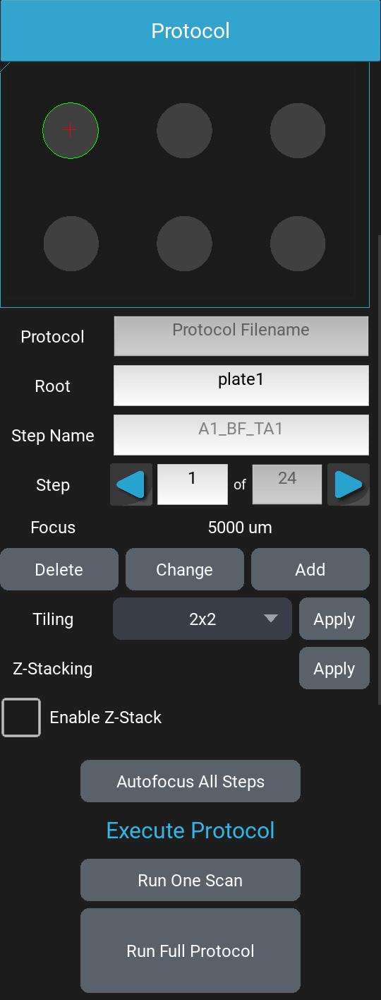

# Protocols {#sec-protocols}

A protocol takes images automatically: at many positions, in several
channels, and again at a set interval over hours or days. It is a list of
steps. Each step is one image, or one video, in one channel at one
position. A scan takes every step once, in order; a time-lapse repeats the
scan.

You build, save, load and run protocols in the [Protocol]{.guilabel}
drawer of the left panel (@fig-protocol-panel). The panel is longer than
the window, so scroll to reach its top and bottom.

{#fig-protocol-panel width=35%}

## A time-lapse of a plate {#sec-protocol-quick-start}

1. Set up each channel you want to image, as for a still image
   (@sec-image-still), and click [Save Focus]{.guilabel} in each.
2. In each of those channels' drawers, set
   [Acquire Settings]{.guilabel} to [Image]{.guilabel}
   (@sec-channel-acquire). To autofocus before each image of a channel,
   turn on its [Auto Focus]{.guilabel} (@sec-channel-protocol-settings).
3. Open the [Protocol]{.guilabel} drawer. On a Lumascope with a motorized XY
   stage, select the labware, and the tiling if you want more than one
   image per well (@sec-protocol-tiling).
4. Set [Interval]{.guilabel} and [Duration]{.guilabel}
   (@sec-protocol-time).
5. Click [New]{.guilabel}. The number of steps is the number of channels
   times the number of wells, tiles and Z-stack slices.
6. Step through a few steps with the arrow buttons and check the image at
   each (@sec-protocol-steps).
7. Click [Save]{.guilabel} and name the protocol.
8. Click [Run One Scan]{.guilabel} to check one pass, then
   [Run Full Protocol]{.guilabel}.

## How often and how long a protocol runs {#sec-protocol-time}

Under [Time Settings]{.guilabel}:

- [Interval]{.guilabel}: the time from the start of one scan to the start
  of the next, in minutes. Default: [20]{.default setting="protocol.period"} minutes.
- [Duration]{.guilabel}: the length of the whole protocol, in hours.
  Default: [48]{.default setting="protocol.duration"} hours.

A full run takes Duration divided by Interval scans, rounded down: 48 hours
at 20 minutes is 144 scans. An interval of 0, or a duration shorter than
the interval, gives a single scan, and you'll see a "Single Scan" message
when the run starts. An interval shorter than 1 second, other than 0, isn't
allowed.

If a scan takes longer than the interval, the next scan starts as soon as
it ends; no scan is skipped, so the protocol ends later than its duration.

## Choosing your plate or slide {#sec-protocol-labware}

*Motorized XY stage only.*

The list below [Time Settings]{.guilabel} selects the labware the
protocol images: Blank, Center Plate, Four-Slide Holder, or a 6, 12, 24,
48, 96, 384 or 1536 well microplate. Default: 96 well microplate. The
labware's wells are shown on the plate map below the buttons, which works
like the one in [XY Stage Control]{.guilabel} (@sec-plate-map).

- A plate gives one position for each well.
- Center Plate gives one position, at the center of the labware holder.
- Blank has no wells: [New]{.guilabel} makes no steps, and you add every
  step with [Add]{.guilabel} (@sec-protocol-add).

To image labware that isn't on the list, add it (@sec-custom-labware).

On a Lumascope without a motorized XY stage the list isn't shown. The
labware is Center Plate, and you position the sample by hand; the plate
map shows the plate but doesn't move anything.

## Making a protocol from your channels {#sec-protocol-new}

[New]{.guilabel} replaces the current protocol with a new one: one step for
each channel set to [Image]{.guilabel} or [Video]{.guilabel}, at every well
of the labware, with the current objective, tiled as [Tiling]{.guilabel}
is set, and Z-stacked if [Enable Z-Stack]{.guilabel} is checked. Each
step uses its channel's settings and saved focus, or the current focus if
the channel has no saved focus.

At each well, the channels follow one another in the order their drawers
are listed. The wells are taken row by row, each row in the opposite
direction to the one before, so the stage doesn't travel back across the
plate between rows: A1, A2, A3, then B3, B2, B1 on a 6-well plate.

New won't run if no channel is set to [Image]{.guilabel} or
[Video]{.guilabel} ("No Channel Set to Acquire"), if the objective isn't
set, or if a tile would lie outside the stage's travel.

A step's name is its well and channel, then its tile and Z-stack slice if
it has them: `A1_BF` is the brightfield image of well A1,
`A1_BF_TA2` its tile A2, and `A1_BF_TA2_Z0` the lowest slice of that
tile's Z-stack.

If a protocol would have more than 10,000 steps, a note below the file
buttons shows its size and how much space its images will take.

## The list of steps {#sec-protocol-steps}

Below the plate map:

- [Protocol]{.guilabel}: the protocol's file name, once it's saved or
  loaded.
- [Root]{.guilabel}: text added to the front of every image file name the
  protocol saves (@sec-protocol-files). Only letters, digits, `-` and `_`
  are kept. The root is saved in the protocol.
- [Step Name]{.guilabel}: the selected step's name. Type a new name and
  press Enter to rename the step. Only letters, digits, `-` and `_` are
  kept; a blank name keeps the old one.
- [Step]{.guilabel}: the selected step's number and the number of steps.
  The arrow buttons select the previous and the next step; type a number to
  go to that step.
- [Focus]{.guilabel}: the selected step's focus, in micrometers. Shown on
  a Lumascope with a focus motor.

Selecting a step moves the stage and the focus to the step's position and
opens the step's channel with the step's settings. To light the step's LED
as you step through, turn on [Preview LED when stepping]{.guilabel} in
Advanced Settings (@sec-advanced-protocol). On a Lumascope with a motorized XY
stage, right-click the plate map to go to the step nearest that point, and
[Show step locations]{.guilabel} in Advanced Settings marks every step on
the map.

### Changing a step {#sec-protocol-change}

To change a step, select it, then:

1. Move to the new position, and focus.
2. Open the step's channel and adjust its settings: the LED, gain,
   exposure, auto gain, autofocus and the rest of the drawer.
3. Click [Change]{.guilabel}.

[Change]{.guilabel} rewrites the selected step using the shown channel and
its settings, the current position and focus, the current objective, and
the name in [Step Name]{.guilabel}. It won't work if the shown channel
isn't set to [Image]{.guilabel} or [Video]{.guilabel}, or while the stage
or focus is moving. It also won't work if another step added along with
this one already uses the shown channel ("Step Not Saved"): steps added
together form one composite, with one image per channel.

On a slice of a Z-stack, Change moves the whole stack: every slice of
every channel there gets the new position and objective, and every slice
of the step's channel gets the channel's settings. A slice keeps its
channel: Change won't work on a slice while another channel is shown.

To change only a step's focus, select it, focus, and click
[Save Focus]{.guilabel} in its channel's drawer (@sec-channel-focus).
On a slice of a Z-stack, a focus saved this way, or by
[Change]{.guilabel}, is used only while the channel's
[Auto Focus]{.guilabel} is off. With it on, the run places the whole stack
around the focus it finds instead (@sec-protocol-autofocus-all), each slice
keeping its spacing from the slice the stack was placed against.

[Delete]{.guilabel} deletes the selected step and selects the one before
it. To delete many steps at once, see @sec-protocol-file.

### Adding steps {#sec-protocol-add}

[Add]{.guilabel} adds steps after the selected step, at the current
position: one for each channel set to [Image]{.guilabel} or
[Video]{.guilabel}. Every added step uses the current focus, not its
channel's saved focus. With [Enable Z-Stack]{.guilabel} checked, each
added step is a Z-stack. Add won't work while the stage or focus is
moving, or while a position isn't known.

Added steps are named `custom` plus a four-digit number that counts up, then
the channel: `custom0000_BF`, `custom0001_BF`. Rename them in
[Step Name]{.guilabel}.

To build a protocol of chosen positions, select Center Plate or Blank,
click [New]{.guilabel}, then move to each position, focus, and click
[Add]{.guilabel}.

## Tiling {#sec-protocol-tiling}

*Motorized XY stage only.*

Tiling images a square grid of fields at each position instead of one
field, from 1x1 (one field, the default) to 10x10. The grid is centered on
the position. Select its size in the [Tiling]{.guilabel} list, then:

- click [New]{.guilabel} to make a protocol tiled at every well; or
- click [Apply]{.guilabel} beside the list to tile every step of the
  current protocol, for example a protocol of added steps.

A protocol can only be tiled once. If any of its steps is already tiled,
[Apply]{.guilabel} won't run ("Protocol Already Tiled"); to change the tiling, make the
protocol again with [New]{.guilabel}, or load the untiled protocol.

Tiles are named by row and column: `TA1` is the first row's first tile,
`TA2` the tile beside it, and `TB1` the first tile of the second row. A
tiled image's name keeps the step's name before it, so the tiles of a well
or of an added step sort together. Stitching doesn't read the names: it
places each tile from the run's record (@sec-pp-stitch).

Tile positions are based on the frame size, binning and objective in use
when the grid is made, and don't change if you change these afterwards
(@sec-frame-size). The overlap between neighboring tiles is
[Tiling Overlap]{.guilabel} in Advanced Settings
(@sec-advanced-protocol).

## Z-stacks in a protocol {#sec-protocol-zstack}

*Motorized focus only.*

A step can be a Z-stack: a series of slices of one channel at evenly
spaced focus positions, set up under [Acquire Z Stack]{.guilabel} in
[Objective Control]{.guilabel} (@sec-zstack). Each slice is a step of its
own, named with `Z` and its number, counting from the lowest.

- [Enable Z-Stack]{.guilabel}: when checked, [New]{.guilabel} and
  [Add]{.guilabel} make every step a Z-stack.
- [Apply]{.guilabel} beside [Z-Stacking]{.guilabel}: turns every step that
  isn't already in a Z-stack into one, placed around the step's focus by
  the top, center or bottom setting in [Objective Control]{.guilabel}.

Neither works if the step size or range isn't greater than 0, or if a
slice would lie outside the focus travel.

## Focusing every step before a run {#sec-protocol-autofocus-all}

*Motorized focus only.*

[Autofocus All Steps]{.guilabel} runs autofocus at every step and saves
the focus it finds as that step's focus. No images are saved. While it's
running, the button reads "Running Autofocus Scan"; click it to stop. If
the scan is stopped or doesn't finish, no step changes, and the same is
true if the protocol was changed during the scan ("Focus Not Saved"). A
finished scan can't be undone, so save the protocol first if you want to
keep the old focus.

A Z-stack is focused once, at its first slice. The whole stack then moves
so the slice it was placed against (its top, center or bottom slice, as
set in [Objective Control]{.guilabel} when the stack was made,
@sec-zstack) is at the focus found; the slices keep their spacing.

## Saving and opening a protocol {#sec-protocol-save}

- [Save]{.guilabel} saves the protocol to its file; if it hasn't been
  saved yet, it asks for a name, like Save As.
- [Save As]{.guilabel} saves it under a new name.
- [Load]{.guilabel} opens a saved protocol and sets each channel to the
  protocol's channel settings.

A protocol is a `.tsv` file; other file types aren't accepted. The
protocol you last saved or loaded opens again the next time LumaViewPro
starts.

If the protocol has unsaved changes to its steps, [Interval]{.guilabel},
[Duration]{.guilabel}, labware or [Root]{.guilabel}, [New]{.guilabel},
[Load]{.guilabel} and closing LumaViewPro ask before discarding them.
Changes in a channel's drawer are not protocol changes.

### Editing the file {#sec-protocol-file}

A protocol file is tab-separated text: a header with the interval, the
duration, the labware and the root; the channels' settings; and the steps,
one row for each step, with its well in the `Well` column. To delete many
steps at once, for example every step of one well, delete their rows in a
text editor or a spreadsheet, keep the file tab-separated with its `.tsv`
name, and load it again.

## Running a protocol {#sec-protocol-run}

Under [Execute Protocol]{.guilabel}:

- [Run One Scan]{.guilabel} takes every step once. While it's running, the
  button reads "Abort One Scan"; click it to stop.
- [Run Full Protocol]{.guilabel} runs the whole time-lapse: a scan every
  [Interval]{.guilabel} for [Duration]{.guilabel}. While it's running, the
  button shows the scans and the time remaining; click it to stop the
  run.

A stopped run keeps the images it has saved. When a run ends while
images are still being written to disk, its button reads "Writing Files..."
with the number still to write. The toolbar's
[STOP]{.guilabel} button also ends a run.

At each step the stage and focus move to the step's position, the step's
channel is shown with its settings, an autofocus runs if the channel's
[Auto Focus]{.guilabel} is on, and the image or video is taken. A
Z-stack is autofocused once, at its first slice, as in
@sec-protocol-autofocus-all. With
[Keep LED on across moves]{.guilabel} in Advanced Settings, the LED stays
on between steps of the same channel (@sec-advanced-protocol).

A run won't start, and you'll see the reason, if the protocol has no
steps ("No Steps"), another run, a composite or post-processing is in
progress, files from an earlier acquisition are still being written, the
microscope or camera isn't ready, a position isn't known, or the
destination folder can't be written to.

While a run is in progress, the protocol, the channel drawers and the
other acquisition controls can't be changed (@sec-showing-a-channel).

## What a run saves, and where {#sec-protocol-files}

Each run saves into a new folder in the destination folder, named with the
date and time the run started: `ProtocolData/20261104_221030/`. It holds:

- one image for each step of each scan, with the root, step and scan in
  its name, the scan counting from 0000: `plate1_A1_BF_TA1_0000.tiff` is the root
  `plate1`, the step `A1_BF_TA1`, and the first scan. On a Lumascope with a
  turret, the name also includes the objective;
- one video for each video step of each scan, its name ending in `_video`;
- a copy of the protocol as it ran, under its file name, or
  `unsaved_protocol.tsv` if it wasn't saved;
- `protocol_record.tsv`, which lists each file saved, with its step, its
  scan and the time it was taken.

Images are saved in the [Sequenced Image Format]{.guilabel}
(@sec-sequenced-format). With [Save channels in separate folders]{.guilabel}
on in Advanced Settings, each channel's images are saved in a folder of
their own inside the run's folder (@sec-advanced-protocol).
