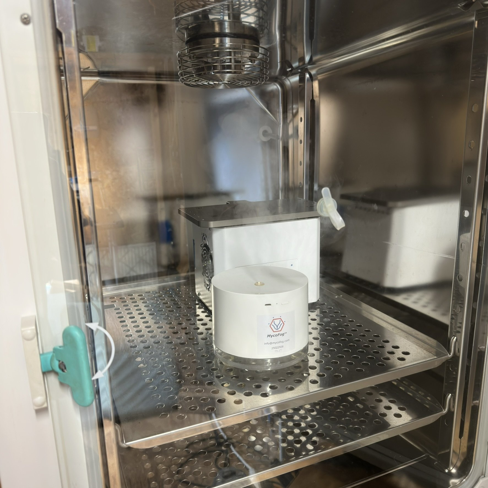

# Sanitizing the microscope {#sec-sanitizing}

A microscope going into an incubator is usually cleaned first. These are the
methods Etaluma recommends.

## Wiping down with alcohol {#sec-alcohol}

Ethanol and isopropanol are the two alcohols most used for their biocidal
action. They disrupt cell membranes, dissolve lipids and denature proteins,
and these processes need water, so the alcohol must be diluted to 60% to 90%
in water to work (typically 70%, by volume). They act on lipid-containing
viruses and a broad range of bacteria, but not on spore-forming bacteria.
They evaporate quickly, so a long contact time is hard to achieve without
immersion. Alcohols are generally regarded as non-corrosive.

## Wiping down with bleach {#sec-bleach}

Chlorine compounds are inexpensive, fast-acting disinfectants with a broad
antimicrobial range. Hypochlorites, the most used, come as liquids (sodium
hypochlorite, as in household bleach) and solids (calcium hypochlorite,
sodium dichloroisocyanurate). Household bleach contains 5.25% available
chlorine, 52,500 ppm. It's a strong oxidizer and loses strength quickly, so
mix it fresh and use it the day it's made.

## Hydrogen peroxide vapor {#sec-hpv}

Hydrogen peroxide vapor kills microbes on contact, mainly by damaging their
DNA and also by oxidizing their proteins and lipids. Given time, the vapor
reaches places that are hard or impossible to clean any other way, so it
decontaminates surfaces very efficiently.

Etaluma recommends MycoFog for decontaminating a CO~2~ incubator this way,
without heat. The Lumascope can stay in the incubator while it's fogged
(@fig-mycofog).

{#fig-mycofog width=60%}

For questions, contact Etaluma Technical Support at support@etaluma.com.
