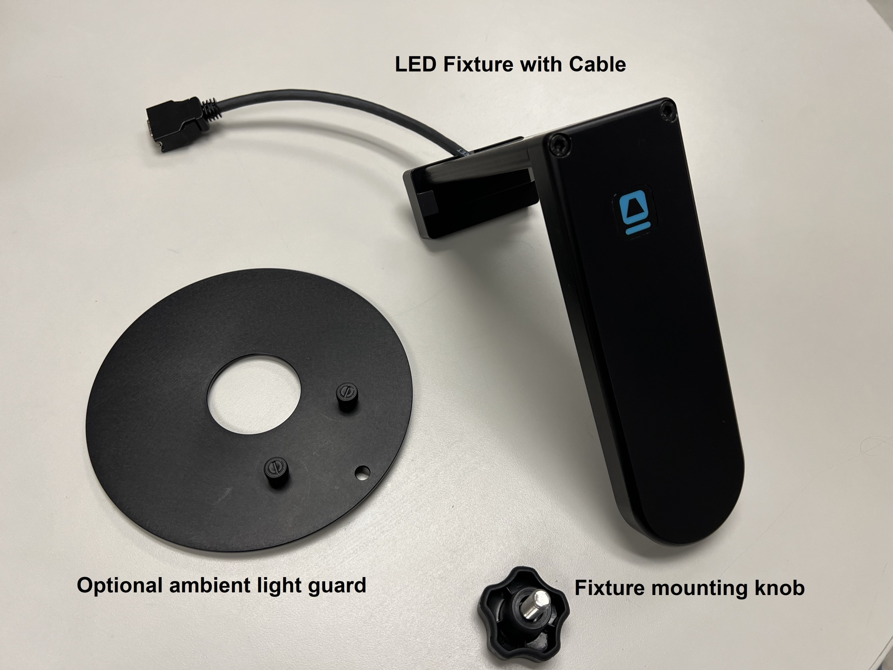
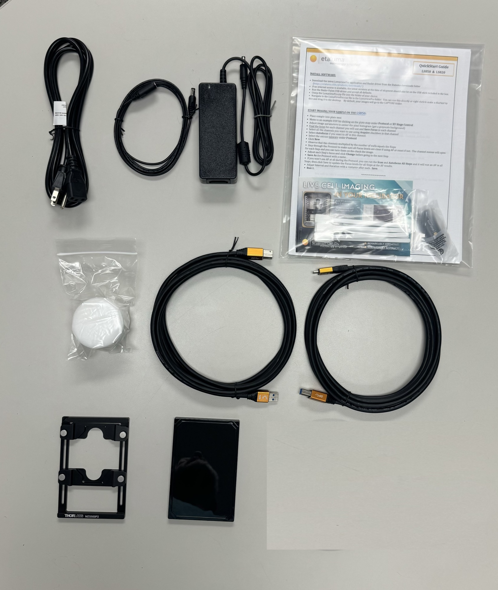
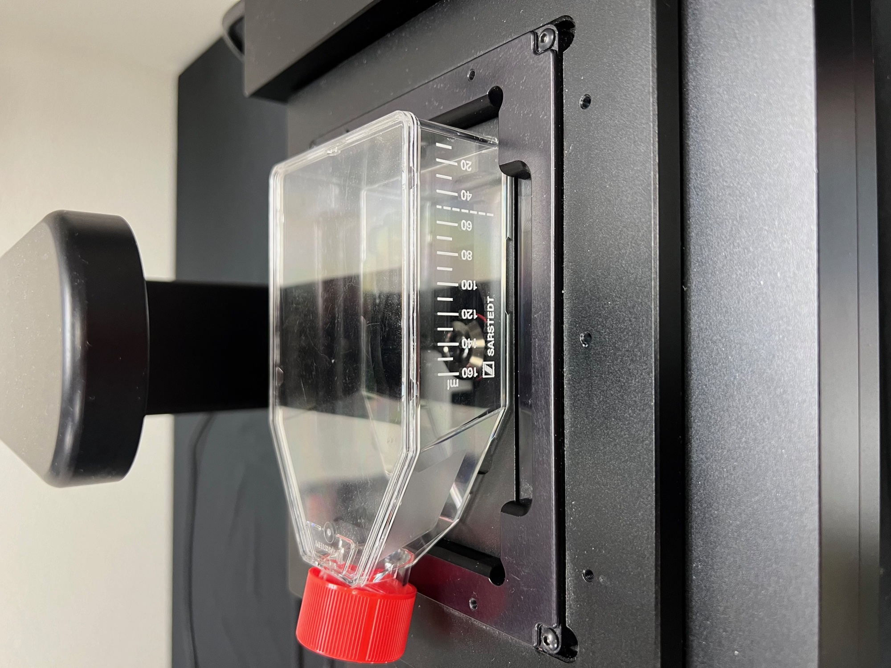
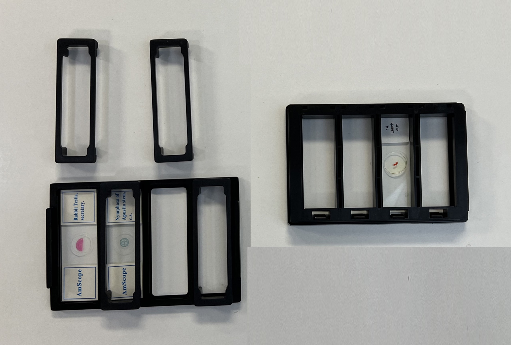
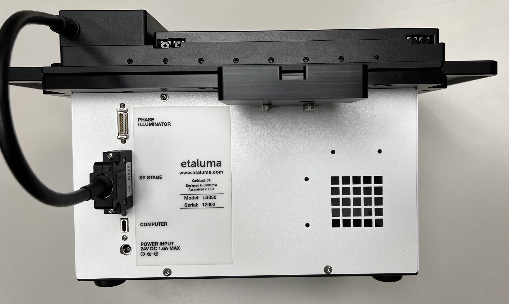
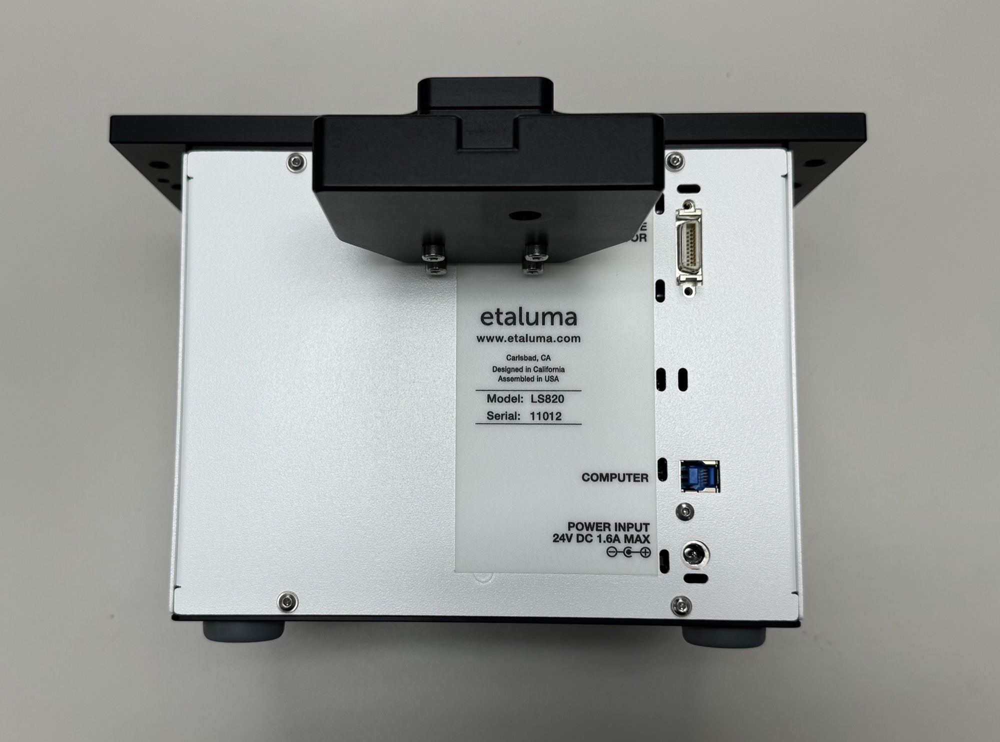
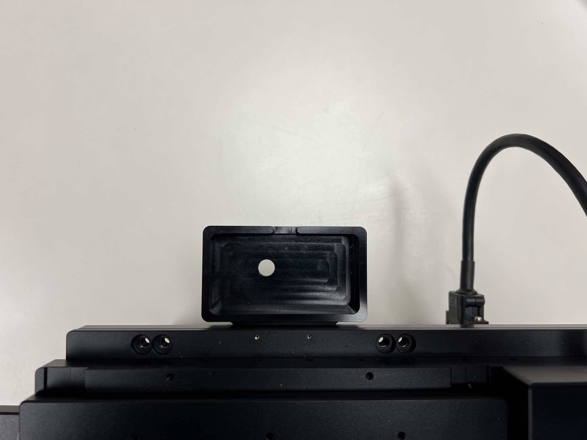
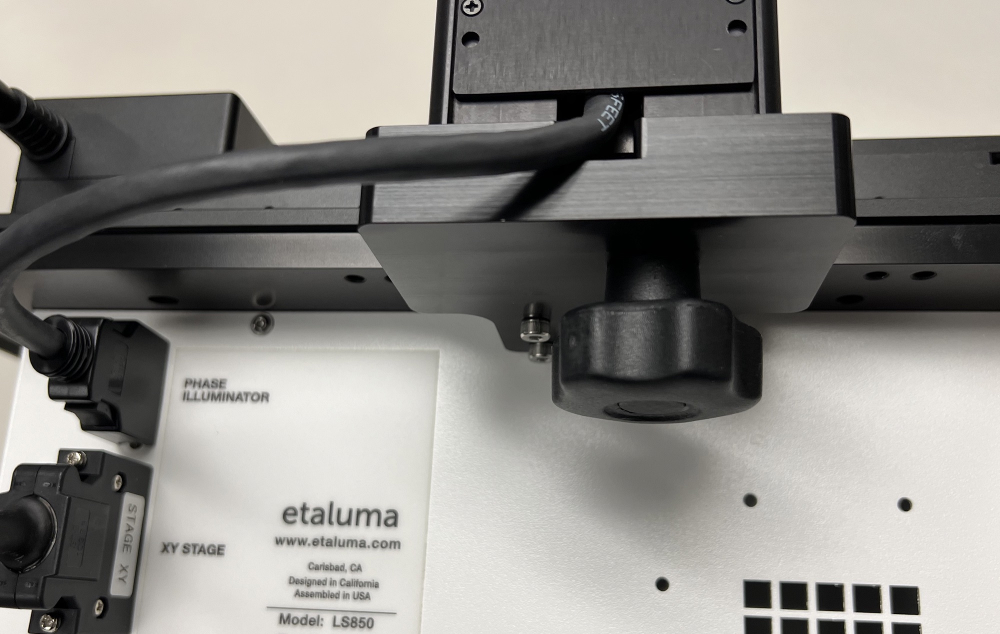

# Setting up the microscope {#sec-setting-up}

## What is in the box {#sec-in-the-box}

Each LS820, LS850, LS850T and Lumi ships with:

- the AuraPhase transmitted illumination accessory: the LED fixture with its
  cable, the fixture mounting knob and an optional ambient light guard
  (@fig-auraphase-parts);
- the accessories (@fig-accessories): a power cord for your country; the AC
  to DC power supply; two USB communication cables, USB-A to USB-B and USB-C
  to USB-B, so that either kind of port on the computer will do; a foam plug
  for the incubator port; a slide holder; a black microplate lid for blocking
  room light during fluorescence imaging; and the quick start guide.

{#fig-auraphase-parts width=70%}

{#fig-accessories width=60%}

## Labware holders {#sec-labware-holders}

The primary labware holder sits in the stage's nest and takes microplates,
dishes and flasks (@fig-labware-holder). A Lumascope without a motorised XY
stage comes with the universal labware holder on its manual stage.

{#fig-labware-holder width=60%}

The optional four-slide holder takes four microscope slides side by side,
held by magnetic clamps (@fig-four-slide-holders). On a scope with a
motorised XY stage, choose the "Four-Slide Holder" labware in
LumaViewPro so that each slide is a position the stage can move to.

{#fig-four-slide-holders width=70%}

## Connecting the cables {#sec-cables}

The microscope's ports are on its rear panel (@fig-rear-ls850,
@fig-rear-ls820):

- **COMPUTER**: the USB cable to the PC. Connect the microscope end now, and
  wait to connect the computer end until LumaViewPro is installed
  (@sec-installing).
- **POWER INPUT 24V DC**: the barrel connector of the power supply. Plug the
  power supply's cord into an AC outlet.
- **PHASE ILLUMINATOR**: the AuraPhase accessory's cable
  (@sec-auraphase).
- **XY STAGE** (a scope with a motorised XY stage): the stage's cable.

{#fig-rear-ls850 width=75%}

{#fig-rear-ls820 width=60%}

## The AuraPhase accessory {#sec-auraphase}

The AuraPhase accessory gives the transmitted channels: brightfield, phase
contrast and darkfield (each model's channels are in @tbl-models).
LumaViewPro switches its LEDs, so it must be connected for the transmitted
channels to light.

To attach it:

1. Place the holes on the bottom of the fixture's bracket over the pegs on
   the mount at the back of the microscope (@fig-auraphase-mount).
2. Tighten the fixture mounting knob beneath the bracket.
3. Connect the fixture's cable to the **PHASE ILLUMINATOR** port
   (@fig-auraphase-connected).

{#fig-auraphase-mount width=60%}

{#fig-auraphase-connected width=70%}

::: {.callout-warning title="Phase contrast and darkfield need the right objective"}
Phase contrast works only with a phase contrast objective (the 10x, 20x and
40x Phase objectives Etaluma supplies), and darkfield only with an objective
of 2x or lower. LumaViewPro lets you light either
channel with any objective; it does not check.
:::

## Installing objectives {#sec-objectives}

Your Lumascope comes with a plastic cap screwed in where the objective goes.
Unscrew the cap and screw in the objective of your choice. On a scope with a
turret, each turret position takes one objective.

When removing the cap or installing an objective, take care not to push the
focus axis, or on a turret scope the turret, out of position. If you think
you may have moved either, restart LumaViewPro: each time it starts, it homes
every axis the microscope has, and on a turret scope it then moves the turret
to position 1.

The objectives come in threaded bottles; keep each in its bottle when it is
not on the microscope. Always keep a cap or an objective in the optics, so no
dust enters, and leave a microplate or lid in the nest when the microscope is
not in use, so no dust settles on the objective.

### Objectives on a turret {#sec-turret-objectives}

Requires: a turret.

When you install only two objectives, put them in opposite positions, so the
turret stays balanced.

::: {.callout-warning title="Tall objectives"}
Tall objectives (100x, and some 60x) can collide with the stage assembly.
Leave the turret positions on either side of a tall objective empty.
:::
