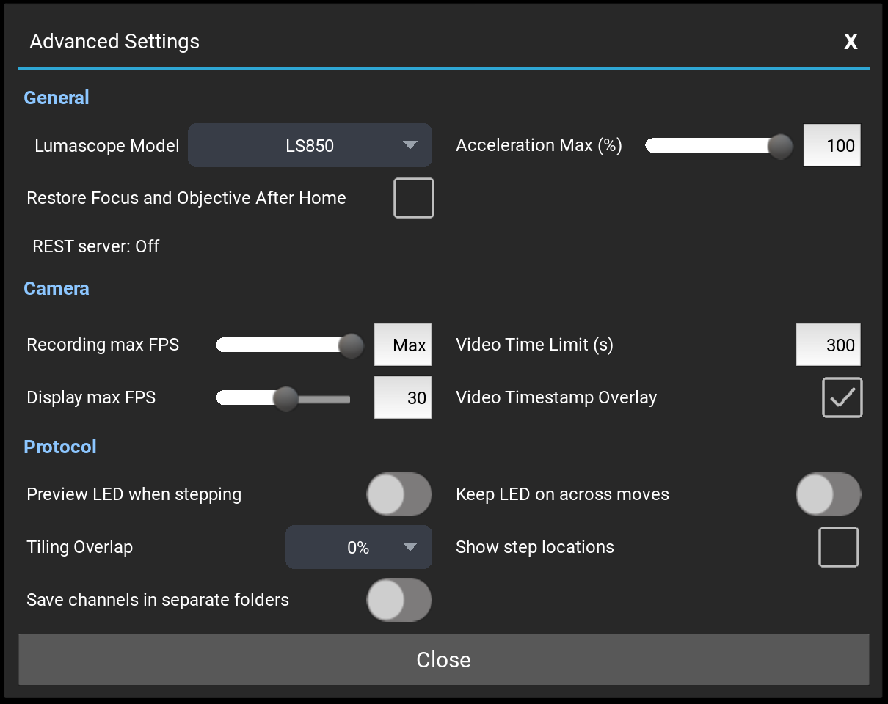

# Settings {#sec-settings}

This chapter describes each setting in [Microscope Settings]{.guilabel} and
in [Advanced Settings]{.guilabel}, once. A setting that needs particular
hardware says so. Settings are saved and restored at the next start, except
where this chapter states otherwise.

A value outside a setting's range is refused, with the reason, and the
setting keeps its previous value; it is never adjusted to the nearest
allowed value.

## Microscope Settings {#sec-microscope-settings}

[Microscope Settings]{.guilabel} is the first drawer of the left panel, open
when LumaViewPro starts (@fig-tour-left-ls850).

### Lumascope Model {#sec-model-line}

The first line shows the model LumaViewPro is running as. On a microscope
that does not report its own model, a different model selected for the next
start is shown after it, for example "(LS560 at next start)". The model is
chosen in
[Advanced Settings]{.guilabel} (@sec-advanced-general).

### Frame Size and Field of View {#sec-frame-size}

[Frame Size]{.guilabel} sets the region of the camera sensor used, in
pixels, width by height. Enter a value in either box and press Enter. The
boxes show the frame size after binning (@sec-binning); at 2x2 each value is
half the number of sensor pixels. The largest frame depends on the model
and its camera (@tbl-max-frame); a larger frame is refused. Default:
1900 x 1900.

On the LS820 and LS850 a frame larger than 2100 x 2100 extends beyond the
objective's field of view.

| Model | Largest frame at 1x1 (pixels) |
|:---|:---|
| LS820, LS850, Lumi | the camera's full sensor, for example 3840 x 2160 |
| LS620, LS720 | 1900 x 1900, the full sensor |
| LS460, LS560 | 1700 x 1700, the largest the lens images |

: Largest frame size by model {#tbl-max-frame tbl-colwidths="[30,70]"}

The frame size cannot be changed while a protocol, a Z-stack, a composite or
an autofocus runs.

The tiles of a tiled protocol are calculated from the frame size and
binning in use when the protocol is created. Run the protocol with the same
frame size and binning.

[Field of View]{.guilabel} shows the width and height of the sample area
the frame covers, in micrometers, calculated from the frame size and the
objective. It shows "unknown" until an objective is assigned in
[Objective Control]{.guilabel}.

### Live Image Format {#sec-live-format}

The file format of images captured manually with the toolbar's Capture
button.

- TIFF: the image with LumaViewPro's metadata. Default.
- OME-TIFF: Open Microscopy Environment TIFF, with full metadata.
- JPG: 8-bit, lossy compression, with the display colors applied and no
  metadata. Files are smaller.

### Sequenced Image Format {#sec-sequenced-format}

The file format of images acquired in a sequence: protocol runs, Z-stacks
and composites.

- TIFF and OME-TIFF: as for [Live Image Format]{.guilabel}.
- Hyperstack: at the end of the run, the images of each well are combined
  into one OME-TIFF stack, which ImageJ and Fiji open through Bio-Formats.
- JPG: as for [Live Image Format]{.guilabel}. A run saved as JPG cannot be
  Z-projected, stitched, combined into a composite or made into a video.

Composites are saved as TIFF or OME-TIFF only. When Hyperstack or JPG is
selected, composites are saved as OME-TIFF.

When either format is JPG, a [JPG Quality]{.guilabel} slider is shown
below them: 1 to 100, default 90. A higher value retains more detail and
produces larger files. It applies to both formats.

### Video Recording Format {#sec-video-format}

The output of video recording, for both the toolbar's Record button and
protocol video steps.

- mp4: a video file that plays back in real time. Default.
- Frames: each frame saved as a separate image, for frame-by-frame
  analysis.

### Image Mode {#sec-image-mode}

The bit depth and encoding of saved images.

- 8-bit: pixel values 0 to 255, as displayed. Default.
- Scientific (full depth): the full bit depth the camera delivers, including
  the extended range of summed images, stored unscaled. These images appear
  dark in standard image viewers because the values occupy only the lower
  part of the file's range.
- Scaled (full depth): the same data scaled to the file's full range, so the
  images appear at normal brightness in any viewer.
- RGB (full depth): full bit depth, saved in the channel's false color.

The mode cannot be changed while a protocol, a Z-stack, a composite or an
autofocus runs. JPG files are always 8-bit; when a full-depth mode is
selected with a JPG format, a note below the mode states that full depth is
kept only in TIFF. A composite's per-channel images are saved in the
selected mode; only its combined image is 8-bit.

### Binning {#sec-binning}

[Binning]{.guilabel} sums each square block of adjacent pixels into one
pixel: 2x2 combines four pixels, 4x4 combines sixteen. Binning increases
sensitivity and reduces resolution. The available sizes are those the
camera supports; 1x1 (no binning) is the default. The
[Frame Size]{.guilabel} boxes update to the binned size.

In [8-bit]{.guilabel} mode the extended range from binning is not retained
in saved images, and a note below [Binning]{.guilabel} states this. Select
a full-depth [Image Mode]{.guilabel} to retain it.

### Enable Scale Bar {#sec-scale-bar}

Draws a scale bar in the lower right corner of the live image and of saved
images, labeled with its length and the objective magnification, for
example "100um, 10x". The bar is drawn in black or white for contrast with
the image. An objective must be assigned in [Objective Control]{.guilabel};
otherwise no bar is drawn. The setting cannot be changed while a protocol
runs, a video records or the stage homes. Default: off.

### Enable Crosshairs {#sec-crosshairs}

Overlays crosshairs and four concentric rings on the center of the live
image. Manually captured images are saved without the overlay; an
additional 8-bit copy with the overlay is saved alongside, with `_overlay`
at the end of its name. This setting is not saved: crosshairs are off at
each start.

### Live Image Contrast Stretching {#sec-contrast-stretch}

Stretches the displayed brightness of the live image to the full range, so
the darkest pixels display as black and the brightest as white. This
reveals detail in dim images. Only the display is affected; saved images
are not changed. Stretching is suspended, and the switch disabled, while a
protocol, a Z-stack, a composite or an autofocus runs. This setting is not
saved: it is off at each start.

### Show Tooltips {#sec-tooltips}

Displays a short description of a control when the mouse pointer rests on
it. Default: off.

### The buttons {#sec-settings-buttons}

[Advanced Settings]{.guilabel} opens the Advanced Settings window
(@sec-advanced-settings). [Generate Support Report]{.guilabel} and
[Zip Logs Only]{.guilabel} create files for Etaluma Technical Support
(@sec-support-report).

While a protocol runs, a video records, or another program controls the
microscope, every control in Microscope Settings is greyed out except
[Generate Support Report]{.guilabel} and [Zip Logs Only]{.guilabel}, so
the logs can be sent while a long run is still going.

## Advanced Settings {#sec-advanced-settings}

The Advanced Settings window (@fig-advanced) groups its settings under
General, Camera and Protocol. Click [Close]{.guilabel}, or click outside
the window, to close it.

{#fig-advanced width=80%}

### General {#sec-advanced-general}

#### Lumascope Model

The model of a microscope that does not report its own. On such a
microscope a change takes effect at the next start of LumaViewPro, and a
notice says so. A microscope whose motor board reports its model runs as
that model at every start; a model chosen there is kept for the next
microscope connected that does not report its own, and a notice says so.
The model cannot be
changed while a protocol runs.

LumaViewPro cannot tell an LS460, an LS560 and an LS620 apart. On these
models, select the correct model here and restart
LumaViewPro; a wrong selection gives the wrong channels.

#### Acceleration Max (%)

Requires: a motorized XY stage.

The maximum acceleration of the motors, as a percentage of the firmware's
maximum: 1 to 100, default 100. Lower values move the stage more gently, for
loosely attached cells.

#### REST server

Shows the state of the REST interface, through which other programs control
the microscope: "Off", "Serving" with its address, or "Not started: see the
log". The REST server is configured in LumaViewPro's settings file, with
LumaViewPro closed (@sec-integrators).

### Camera {#sec-advanced-camera}

#### Recording max FPS

The maximum number of frames per second a recording keeps, for both the
toolbar's Record button and protocol video steps: 1 to 200, or Max at the
top of the slider, which keeps every frame the camera delivers. Default:
Max. The camera and the live image are not slowed.

#### Video Time Limit (s)

The maximum duration of a recording made with the toolbar's Record button:
1 to 3600 seconds, default 300. Recording stops automatically at the limit;
press Record again to stop sooner.

#### Display max FPS

The maximum frame rate of the live image display: 1 to 60, or Max, which
draws every frame. Default: 30. Lower values reduce the load on the
computer. Recordings and captures are not affected.

#### Video Timestamp Overlay

Burns each frame's capture time into the frames of a recording, for both
manual recordings and protocol video steps. Default: on.

### Protocol {#sec-advanced-protocol}

#### Preview LED when stepping

Keeps each step's LED on while stepping manually through a protocol's
steps, to preview each step's illumination. LED behavior during a protocol
run is not affected. Default: off.

#### Keep LED on across moves

During a protocol run, keeps the LED on while the stage moves between
consecutive steps of the same channel, instead of switching it off and on
again, which shortens the scan. It does not apply to autofocus scans.
Default: off.

#### Tiling Overlap

Requires: a motorized XY stage.

The overlap between adjacent tiles, as a percentage of the frame: 0%, 10%,
15% or 20%, default 0%. It applies to tiles created after the change. With
an overlap, stitching aligns tiles by matching image content; at 0%, tiles
are placed by stage position alone.

#### Show step locations

Requires: a motorized XY stage.

Marks each protocol step with a yellow cross on the plate map in
[XY Stage Control]{.guilabel}. Default: off.

#### Save channels in separate folders

Saves each channel's images in a separate folder named for the channel, for
both manual captures and protocol runs. The setting is read when a protocol
starts and is not stored in the protocol. Default: off.
