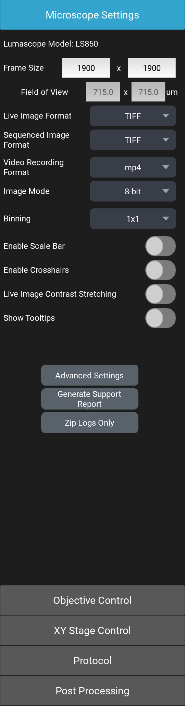
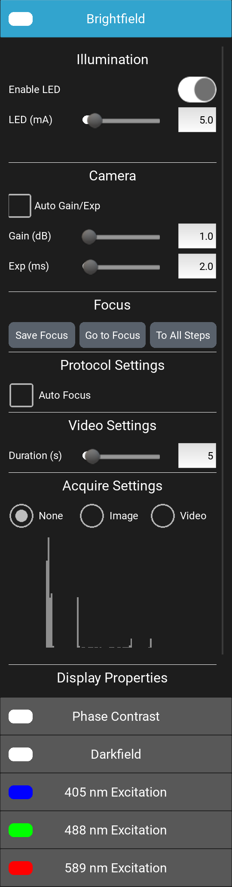

# A tour of LumaViewPro {#sec-tour}

This chapter names the parts of the LumaViewPro window, so the chapters
after it can say where each control is. Each part is described in full in
its own chapter.

## Starting LumaViewPro {#sec-starting}

Start LumaViewPro from its desktop or Start menu shortcut, with the
microscope connected and powered (@sec-connecting). LumaViewPro finds the
microscope, starts its camera and LEDs and, on a Lumascope with motors, homes
them: the focus is lowered completely, and the XY stage and the turret are
driven to their home positions. On a Lumascope with an XY stage, the stage
then moves to the middle of its travel, and the focus rises to a little above
its lowest point. While the Lumascope homes, "System Homing..."
is shown over the middle of the window. Wait for it to clear before you
use the microscope.

If the microscope is not found, see @sec-not-found.

## The window {#sec-window}

LumaViewPro fills the screen (@fig-tour-window). The live image from the
camera is in the middle. A panel down each side holds the controls: the
microscope, focus, stage, protocols and post-processing on the left, and the
channels on the right. The toolbar sits along the bottom of the live image,
and the status line below it.

{#fig-tour-window width=100%}

Both side panels are open when LumaViewPro starts. To close a panel and
give the live image more room, click the blue arrow on its inner edge;
click the arrow again to open it.

Every control has a tooltip, a line saying what it does. To see them,
switch on [Show Tooltips]{.guilabel} in Microscope Settings, then rest the
mouse pointer on a control.

## The left panel {#sec-left-panel}

The left panel is a stack of drawers (@fig-tour-panels). One drawer is open
at a time: click a drawer's title to open it, and the drawer that was open
closes. When LumaViewPro starts, [Microscope Settings]{.guilabel} is open.

- [Microscope Settings]{.guilabel}: the camera's frame size and binning, the
  formats images and videos are saved in, the image mode, the display
  switches, [Advanced Settings]{.guilabel}, and the support report buttons.
- [Objective Control]{.guilabel}: focus, autofocus, Z-stacks, the objective
  in use and, on a Lumascope with a turret, the turret.
- [XY Stage Control]{.guilabel}: moving the XY stage, and the plate map.
  Shown only on a Lumascope with a motorized XY stage; an LS820 or a Lumi has no
  such drawer.
- [Protocol]{.guilabel}: building, saving, loading and running protocols.
- [Post Processing]{.guilabel}: stitching, composites, Z-projection, video
  from images, and object analysis.

::: {#fig-tour-panels layout-ncol=3}
{#fig-tour-left-ls850}

{#fig-tour-left-ls820}

{#fig-tour-right}

The side panels
:::

## The right panel {#sec-right-panel}

The right panel has one drawer for each channel your microscope has
(@tbl-models), titled with the channel's name: for example
[Brightfield]{.channel}, [Phase Contrast]{.channel}, [Darkfield]{.channel},
[488 nm Excitation]{.channel} or [Lumi]{.channel}. A fluorescence channel's
drawer is named for its excitation wavelength, and its color swatch is the
color that channel is shown in. As on the left, one drawer is open at a
time; opening a channel's drawer shows that channel in the live image.

Each drawer holds that channel's own settings: its LED, the camera's gain
and exposure, its saved focus, what a protocol acquires in it, and a
histogram of the live image's brightness. @fig-tour-right shows the
[Brightfield]{.channel} drawer.

## The toolbar {#sec-toolbar}

The toolbar's buttons are pictures (@fig-tour-toolbar). From left to right:

{#fig-tour-toolbar width=60%}

| Button | What it does |
|:---|:---|
| Open last save folder | Opens the folder LumaViewPro last saved to, in Windows File Explorer. Before anything is saved, it opens the destination folder. |
| Destination folder | Chooses the folder every image and video is saved under. Not available while a protocol runs or a video records. |
| Freeze | Freezes the live image, and unfreezes it. Only the display stops: the LEDs, captures, recordings and protocols carry on. |
| Capture | Saves the live image, named for the channel shown. |
| Composite | Captures each channel set to acquire an image and combines them into one composite image. Needs two or more such channels. |
| Record | Records the live image as a video, until it is pressed again or the time limit is reached ([Video Time Limit (s)]{.guilabel} in [Advanced Settings]{.guilabel}, 300 seconds unless changed). |
| Fit | Fits the whole live image to the window. |
| 1:1 | Shows the live image at one camera pixel to one screen pixel. |
| [STOP]{.guilabel} | Stops every motor at once and ends a running protocol. Shown only on a Lumascope with motors. |

: The toolbar's buttons {#tbl-toolbar tbl-colwidths="[22,78]"}

Everything is saved under the destination folder: what you take by hand in
`Manual`, and a protocol's images in `ProtocolData` (@sec-image-files).

## The live image {#sec-live-image}

Scroll the mouse wheel over the live image to zoom in and out, and drag the
image to move around it when zoomed. Fit and 1:1 on the toolbar set the zoom
back. With Ctrl held, the mouse wheel moves the focus instead.

## The status line {#sec-status-line}

The line along the bottom of the window shows two frame rates: Capture, the
frames per second the camera delivers, and Display, the frames per second
the screen shows. With the mouse pointer over the live image it also shows
the camera pixel under the pointer, as Pixel (x, y), and, on a Lumascope with a
motorized XY stage and a known objective, that point's position on the
plate, as Plate (x, y) mm.
