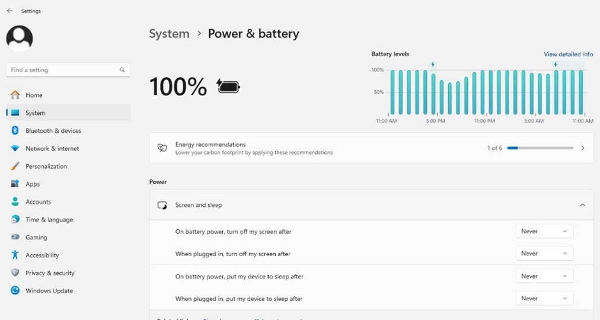
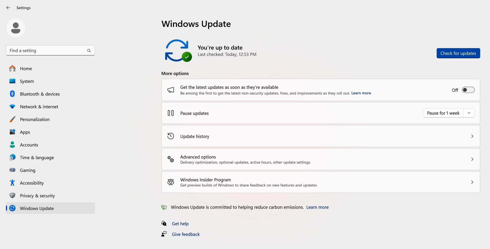
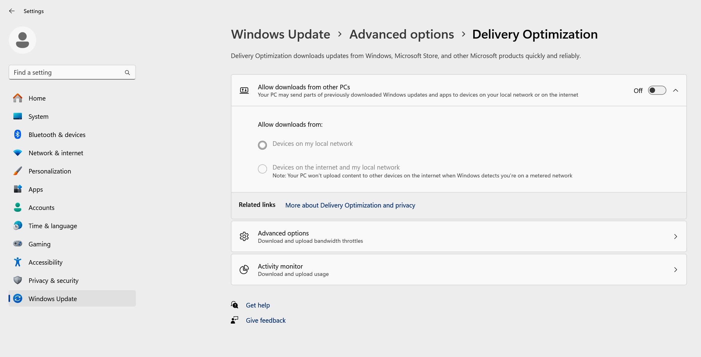

# Setting up Windows for a time-lapse {#sec-windows-timelapse}

A computer that sleeps, or restarts for an update, interrupts a run.
Before a long time-lapse, set up Windows 11 as below.

## Power {#sec-windows-power}

While a protocol runs or a video records, LumaViewPro keeps the computer
from going to sleep when it is left idle. The screen may still turn off,
which does not affect the run. Closing a laptop's lid, choosing Sleep, or a
restart for an update still interrupts the run.

If LumaViewPro cannot keep the computer awake, it shows the notice
"Computer may sleep" and the run goes on. Then open Settings (the Start
button, then the gear), choose System, then Power & Battery, and set every
sleep time to Never (@fig-windows-power).

{#fig-windows-power width=80%}

## Network {#sec-windows-network}

If the computer does not need a network during the run (recommended):

1. Unplug the Ethernet cable, if there is one.
2. Turn on Airplane Mode: Settings, Network & Internet, Airplane Mode, On.
   This stops all wireless communication: Wi-Fi, Bluetooth and cellular.
   Do not reconnect to a network afterwards: that turns Wi-Fi back on.

If the computer needs a network during the run:

1. Open Settings, Network & Internet, Wi-Fi.
2. Choose Manage known networks, then for each of your networks set
   "Make this PC discoverable" (if offered) to Off and "Metered connection"
   to On. On a metered connection Windows downloads only critical updates.

## Windows Update {#sec-windows-update}

1. Open Settings, Windows Update (@fig-windows-update).
2. Set Pause updates to a period that covers the whole run, up to five
   weeks. When the pause ends, Windows installs the pending updates and may
   restart; start the next run after that.
3. Choose Advanced options, then Delivery Optimization, and set "Allow
   downloads from other PCs" to Off (@fig-windows-delivery).

{#fig-windows-update width=90%}

{#fig-windows-delivery width=90%}
